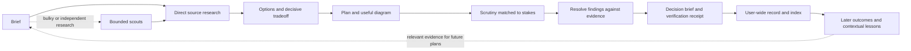

# agentic-toolkit — Architecture

A debate review pipeline, a standalone planner, two utility skills, and an automatic learning runtime. The review pipeline challenges finished work and caps its fan-out. The planner matches scrutiny to the decision's stakes and records evidence limits. Planning and debate decisions are prose run by the host agent; a stdlib helper serializes planning-session registration. Self-learning adds deterministic Python hooks, a queue, and a bounded background worker.

| Skill | Does | Agents |
|---|---|---|
| [self-learning](#self-learning) | automatic cross-session procedural learning and improvement proposals for Claude and Codex | one bounded headless CLI call per eligible reflection |
| [planning](#planning) | concise plans with source evidence, diagrams, alternatives, and optional critique | 0 / 1 / 2 fresh review contexts inferred from the task; optional scouts, two calls by default |
| [adversarial-review](#adversarial-review) | cross-model debate review of finished work — diff, working tree, or documents | 4 + 2 Codex calls |
| [session-migration](#session-migration) | find any past session, route it to the surface you want | none |
| [cf-access](#cf-access) | keep CLI tools, Node clients and MCP servers authenticated to Cloudflare Access | none |

## self-learning

~~~mermaid
flowchart LR
    H[Claude and Codex hooks] --> Q[Shared SQLite queue]
    Q --> E[Bounded project evidence]
    E --> R[Headless reflection]
    R --> V[Host validates evidence and scope]
    V --> S[Generated procedural skills]
    V --> P[Workflow improvement proposals]
    S --> C[Relevant context at startup and prompts]
    P --> C
    C --> H
    E --> F[Explicit later user outcomes]
    F --> V
~~~

`upstream_queue.py` is vendored unchanged from a pinned MIT-licensed Self-Improving Skills commit. It owns deduplication, coalescing, single-worker ownership, retry states and crash recovery. `learning.py` adds project identity, evidence, budgets, versioned artifacts, delivery receipts and SQLite FTS5 relevance search. Git worktrees sharing a local common Git directory share scope.

`evidence.py` normalizes transcripts at captured row cutoffs, preserves user intent in long traces, and redacts common credential shapes. Raw transcripts remain in their host locations; selected excerpts and generated artifacts live in private local state. Recall ignores generic request words and waits for task terms before injecting skills or consuming a proposal notification; startup without a task only checks health notices.

`reflection.py` runs an installed CLI in a disposable directory with tools/customizations disabled where supported, a read-only Codex sandbox, structured output, a timeout and process-group cleanup. The model returns data. The host validates the entire output before publishing generated artifacts; it cannot edit existing user skills or external systems.

Skills and proposals need user evidence from two independent sessions. Skills additionally need observed tool results. Repetition is a synthesis gate, not proof of correctness. Explicit harmful feedback withdraws artifacts. Automatic outcomes must cite user evidence strictly after the delivery snapshot in that source session; loading a skill and silence are not usefulness signals. Injected guidance explains asynchronous feedback processing and keeps proposed infrastructure distinct from existing capabilities.

`discover` bypasses `Store` initialization and opens a read-only SQLite snapshot. Project/native-session filters include historical supporting evidence, deliveries, and attributable reported outcomes separately. Explicit artifact selections remain project-scoped; manual feedback has no invented source. Listing does not call reflection, alter settings or create delivery/usefulness receipts.

Installation merges owned native hooks into both hosts and symlinks the management skill. Generated procedures live in one canonical scoped store; context hooks supply them to either host. Reflection is event-driven; quota-limited work waits for later source activity. [Operating details and attribution](docs/self-learning.md).

## planning

The skill, default library (`~/.local/share/planning/`), environment override (`PLANNING_HOME`) and session marker (`planning-session`) share the same name. The helper accepts older configuration and markers, and discovers the old default library when the new one is absent. Historical snapshots and stable record IDs retain their original names.

Planning ends with a decision brief and handoff. The planner may inspect code and run permitted checks, but writes only planning artifacts and disposable probes. Product implementation is a separate authorized phase, possibly performed by the same agent. This is a role boundary, not filesystem enforcement.



Two instruction files separate the planning workflow from storage: `SKILL.md` includes intake, grounding, design, output and optional scout/review procedures; `records.md` contains the storage contract and commands. It infers scrutiny from uncertainty, consequences, reversibility, and dependencies, without named effort modes. The embedded review procedure applies only when a fresh critic or blind alternative could change the plan or resolve a consequential gap. A critic may receive one targeted follow-up. Adding a blind alternative permits at most two dispute rounds within six total review calls, including earlier critic calls; escalation never resets the count. Initial judgments remain separate, and settled disputes or no new evidence stop review early. Fresh contexts may share a model; the receipt must say so.

Intake distinguishes desired outcomes from suggested mechanisms and challenges only consequential unsupported premises. Scope selection checks necessity without dropping explicit requirements or other requested outputs. Acceptance describes finished outcomes; required methods remain constraints and consequential design choices stay in the architecture. Synthesis preserves decisions, corrections and evidence status. These checks refine existing stages; they add no mandatory interview, panel or schema. Version 0.9.0 condensed the instructions; 0.9.1 consolidates them into two files while preserving the procedures, helper and storage contract; [comparison and limits](docs/planning-research/refinement-evaluation.md).

The embedded scout procedure applies only when research benefits from delegation. Direct research and parallel tool calls are the default. Scouts get bounded, distinct questions and return claims, source/version pointers, counterevidence, and gaps. The default research cap is two scout calls including follow-ups, separately counted from review and adjustable by the user's budget. No recursive delegation is permitted. The planner opens decisive sources and reconciles contradictions; a scout cannot become the fresh critic of its own work. Bulk evidence can stay behind links without losing provenance.

Substantial artifacts have a default organizing shape: intended result and scope, relevant baseline, proposed solution and decisions, delivery sequence, acceptance, and material uncertainty. Sections can be merged, reordered or omitted; the subject determines the structure. Central concepts receive more depth than smaller proposals. Lists separate meaningful points with their essential conditions; prose explains connections. The current plan retains binding decisions and rationale; bulky research, receipts and superseded history stay linked. Editing checks preservation and findability without imposing a template, paragraph quota or equal-size sections.

System designs and implementation handoffs choose mechanisms: cooperating responsibilities, meaningful inputs/outputs, ownership, interactions and important lifecycle/failure behavior. A compact data shape, state model or example can express a consequential contract; routine file layout, helper signatures and code bodies remain implementation choices. Deliverables derive from the design and dependencies, with observable results; an early end-to-end slice is useful when it reduces integration risk, while prerequisites and migrations remain valid. The overall design and first delivery have distinct scope. Product plans describe intended behavior and outcome hypotheses; research plans define discriminating observations and decision rules.

Self-check and fresh review assess the user's requested outcome and scope, including representative normal and material failure/ambiguity cases for system designs. A reasoned walkthrough is not an executed check. A preferred option does not settle an unsupported essential capability; blockers name the bounded observation, decision criterion and affected work. Readiness of an independent slice does not establish readiness of the whole requested design. Routine implementation checks may remain pending. The [output comparison](docs/planning-research/concrete-handoffs-evaluation.md) records the evaluated instruction snapshots and limits.

Claims carry evidence states rather than confidence percentages. Deterministic checks or disposable probes may help when permitted, but a planned test is not an executed result and model consensus is not proof. Bulky evidence and review receipts stay behind links. The plan's dependencies, acceptance criteria, and diagram must agree before handoff.

`--review` preserves the supplied plan unless edits were requested. A missing reviewer degrades to self-checking with explicit limits. Model selection inherits the host unless a different available model is authorized; the skill has no hardcoded model or required external provider. User time, cost, scope, and delegation limits take precedence over inferred scrutiny. Call caps are instruction-level controls, not enforced monetary budgets.

`records.md` defines the user-wide library and its `--store DIR` / `PLANNING_HOME` overrides. New work lives in readable `sessions/<topic>/` folders; a `README.md` entry owns stable session identity, title, project scope, native source references and grouping. Plans retain independent IDs and canonical contents, expectations, decisions and outcomes. Legacy records and explicit destinations remain usable in place.

`sessions.py` uses a library lock, reads entries under that lock, and atomically replaces entries/indexes. Explicit identity wins; source association can resume only one unambiguous same-project session. A creation key distinguishes work from titles and makes concurrent retries converge; collisions get readable suffixed folders. Session titles change only deliberately, and title updates retain stable folder paths. Entries are authoritative for grouping; the index is rebuildable. Incomplete indexing is reported after preserving saved artifacts.

Optional foreground discovery queries self-learning by project and native sources and refreshes a timestamped derived snapshot. Explicit canonical links survive refresh failures or changed matches. The learning runtime never writes planner entries; its database, generated skills, evidence gates and budgets remain unchanged. Planning works without learning. Physical relocation is deferred. [Contract and commands](skills/planning/records.md), [temporary-fixture pilot](docs/session-artifacts.md).

The [research dossier](docs/planning-research/overview.md) explains source selection, tradeoffs, and alternatives. The [evaluation record](docs/planning-research/evaluation.md) distinguishes observed pilot behavior from unmeasured quality/cost claims. [Research decisions and outcomes](docs/planning-research/outcomes.md) connects that evidence to the current skill and documents the storage boundary.

## adversarial-review

Two independent reviewers (Claude, Codex) review the same target, argue until they agree or deadlock, then a judge re-verifies the survivors in the files.

```
             ┌────────────┐
             │   Scope    │    cheap agent: file list, summary, diff command
             └──────┬─────┘
             ┌──────┴─────────┐
             ▼                ▼
      ┌────────────┐   ┌────────────┐
      │   Claude   │   │   Codex    │      independent reviews,
      │  subagent  │   │ codex exec │      neither sees the other
      └─────┬──────┘   └─────┬──────┘
            ▼                ▼
      ┌────────────┐   ┌────────────┐
      │  each side │   │  each side │  ◀─┐  round 1: verdicts on the
      │  attacks,  │   │  answers,  │    │  other side's findings
      │  concedes  │   │  re-judges │    │  rounds 2+: only what is
      └─────┬──────┘   └─────┬──────┘    │  still disputed
            └───────┬────────┘───────────┘  until agreed, stuck, or capped
                    ▼
             ┌────────────┐
             │ Synthesis  │    judge: arbitrates deadlocks, re-verifies
             │   judge    │    in the files, confirms
             └────────────┘
```

### Structure

- The main thread orchestrates only: it owns whose finding is whose and what is still disputed, and never reads the target or takes a side.
- Every stage returns JSON against a shape stated in its prompt — one contract for both legs.
- Prompts carry a file list and a diff command, never the diff, so the same review works on 3 files or 66.
- The Codex leg is `codex exec --sandbox read-only --output-schema … -o answer.json`; its reasoning transcript stays out of the orchestrator context, and its answer passes through verbatim.

### Decisions

- **A plain skill, not an orchestrator script.** Nothing here needs deterministic control flow: gates are conversations, loops are bounded by stated counts. The cost is that loop guards are instructions rather than code.
- **Scope is an agent, though it is only git.** Inline, the diff lands in the one context that must survive the whole run, and "never review the target" decays from a boundary into an instruction.
- **Findings carry an evidence requirement.** A `defect` needs a concrete failure scenario; a `design` finding needs a concrete better alternative. Severity anchors on merge impact.
- **Round 1 cross-examines against the files.** Plausibility judgments are banned. This is the hallucination filter.
- **Later rounds allow two moves:** concede citing evidence, or defend with evidence not already given. Deferring is not a resolution; repetition is a deadlock. Without those rules a debate converges on whoever argues hardest ([consensus cost](https://arxiv.org/html/2605.00914v1), [debate or vote](https://arxiv.org/abs/2508.17536)).
- **Judge verification is tiered.** Highs get opened; an uncorroborated high must survive a refutation attempt; lows ride on the record, where a miss costs least.
- **Independent agreement outranks agreement reached mid-debate.** The judge treats the latter as one reviewer's finding that survived an argument.
- **The fix loop has three guards:** a mutation guard (touching a file no finding names halts the run), anti-anchoring memory, and a stagnation fingerprint.
- **A missing Codex degrades, never aborts.** A fresh Claude critic stands in, so nothing reaches the judge uncontested.
- **One depth knob.** `--effort` shares its axis with `/code-review`: low buys precision, high buys coverage.

### Result contract

Prose to the user, plus one temp file at the end of the run:

```jsonc
{
  "status": "clean | issues-found | stagnant | max-iterations | scope-violation | nothing-to-review | error",
  "target": "origin/main", "iterations": 1, "rounds": 2, "effort": "medium", "codexAvailable": true,
  "confirmed": [ { "id", "kind", "file", "line", "severity", "title", "description",
                   "agreement", "settled", "fixRecommendation" } ],
  "rejected":  [ { "id", "reason" } ],
  "conceded":  [ { "id", "title" } ],
  "fixed":     [ "issue ids (fix mode)" ],
  "summary":   "judge's narrative verdict"
}
```

## session-migration

No subagents, no debate. Two mechanisms hide past work: desktop session records are scoped per account, so an account switch strands everything before it, and terminal sessions get no desktop record at all. Both are invisible to the sidebar and to `list_sessions`.

```
~/Library/Application Support/Claude/claude-code-sessions/<accountId>/<orgId>/local_<uuid>.json   ← account-scoped record
~/.claude/projects/<slug(cwd)>/<cliSessionId>.jsonl                                               ← transcript, account-agnostic
~/.claude/jobs/<first-8-of-cliSessionId>/{state.json,timeline.jsonl}                              ← CLI `claude agents` registry
```

The transcript is the durable artifact; the other two stores are pointers to it. So most of what looks like migration is writing the missing pointer:

| Destination | Route | Cost |
|---|---|---|
| desktop sidebar, now | `import` — the `claude://resume` deep link | new record id, metadata reset |
| desktop sidebar, intact | `move` — relocate the record | full app restart |
| terminal | `resume` — print `claude --resume` | none; the transcript was always reachable |
| `claude agents` | `job` — synthesize the registry entry | none |

### Decisions

- **Three app behaviours drive the rest.** Records live in an in-memory map rebuilt only on launch or account switch, so a copied file stays invisible until restart. The deep link builds a fresh record from the transcript *in the current account* — the only path avoiding one. And the app's own recovery scan skips any transcript held under *any* account, so a stranded session must be reached deliberately.
- **`import` and `move` are mutually exclusive.** They produce different record ids, so running both puts one conversation in the sidebar twice. Each refuses when the other has run.
- **A live background agent blocks every `claude --resume` route.** The claim is a socket, not a status: a job reading `done` can still hold it, and no UI shows it. All routes preflight it and name the holding pids; `--force` is deliberately powerless, because the refusal comes from the CLI.
- **Fuzzy by default.** The trigger case is a half-remembered name. Ambiguity is surfaced, never guessed — two close candidates print and stop.
- **The CLI is always searched.** Scoping to desktop records skipped ~90% of sessions on a real machine.
- **Nothing is destroyed.** `move` renames, `--copy` duplicates, an existing destination is refused. The one removal is a tombstone under `--force`.
- **Never patch a loaded record** — the in-memory copy wins and overwrites disk, so renames go through the app's own API.
- **Verify before reporting**, the one habit shared with the debate skills.

### Result contract

Plain stdout, not JSON: the consumer is the agent's own reading. Every mutation prints source path, destination path and the refresh the user must perform. `--dry-run` on every mutating subcommand prints that report and writes nothing.

## cf-access

The only skill that installs a background process.

An Access app with an IdP-only policy has no service-token path. Its JWT comes from a browser SSO round-trip and lasts about a day. So any client that reads its credential once at startup works for a day, then fails with a login redirect. Three layers, chosen by how much the client can change.

```
cf-access              broker: mint / cache, one place that knows how
   ↑ per invocation                    ↑ per request
shell, curl, MCP launchers      cf-access-proxy ── 127.0.0.1:8780 (dynamic, header names upstream)
                                        │      └─ 127.0.0.1:<port> (fixed route, any language)
                                        ↑
                           cf-access-preload.cjs (NODE_OPTIONS=--require, patches http/https/fetch)
```

### Decisions

- **A broker, not per-client auth.** Every client gets a token or a URL. Nothing else knows `cloudflared` exists, so a newly gated tool is a config line.
- **Origins, never paths.** `cloudflared` caches per hostname, so a path misses the cache and re-mints forever.
- **`login` clears the cache first**, or `cloudflared` returns the cached token and the refresh is a no-op. The old token is stashed and restored on failure.
- **Cache files are found by the token's `aud`.** A hostname glob misses apps under a wildcard policy.
- **Gating is learned, not configured.** The first request to an origin goes out bare; only a login redirect proves a token is needed.
- **A credential on the request wins, unless Access rejects it.** The broker steps in only on rejection, so working auth is never swapped for a login the client cannot perform.
- **The login deadline lives in the broker**, where every caller routes through. It settles the mint rather than waiting for the child to die: `cloudflared` ignores `SIGTERM` and holds its pipe open.
- **A bounded hold, not an unbounded wait.** A request waits, then gets `511` while the login continues; the retry finds a token, so a human tap never races a client timeout.
- **The allowlist is domain suffixes, and it is the security boundary.** Without it the loopback port is an open forwarder. No file means allow nothing. One implementation serves proxy and preload, because two would drift into either half of the failure. Re-read on a short TTL, not watched — a watcher in the preload would stop every Node process exiting.
- **Single-flight minting with a login cooldown.** A stampede collapses into one mint per origin; the cooldown stops a burst of failures stacking up browser tabs. Tokens are never renewed early: near a session cap a re-mint cannot beat the old exp, so a live token is served until it dies.
- **A browser window names its cause.** Every SSO path crosses one funnel, so the trace is emitted there. It fires before the attempt, since a line that waited for the mint would arrive after the window it explains. Single-flight keeps it honest — only the request that starts a mint is named.
- **A caller with no trace supplies its own.** Direct mode is the case that most needs explaining — a window from a shell or an agent's Bash call is the one nobody can account for later — so the broker names and logs itself. Only a login typed at a terminal skips the page: a tty proves someone knows who asked.
- **Where no client can identify itself, the route does.** A fixed-port client sits on loopback and knows nothing about cf-access, and the preload must not divert `127.0.0.1`. So a label on its config line becomes that traffic's name.
- **The explanation is in the window too, and cannot be an iframe.** The IdP refuses framing, and a frame would partition the org session cookie. So a proxy-opened login lands on a local page that links out.
- **The client names itself.** The preload knows its own process; the proxy could only guess from a socket. Identity and session are separate headers, so no layer parses another's text.
- **Ids on the wire, names at the edge.** The preload must cost nothing, so reading session records is the page generator's job. It degrades in steps — title, worktree, directory — since a title lands only after the first turn and a terminal session has no desktop record at all.
- **What reaches the log is an allowlist.** Process ids, script name, session id, request path without its query. Never argv, environment values or headers — all three carry credentials. Wire values are quoted and bounded.
- **Our own headers never leave the proxy.** The whole namespace is stripped, so the next one is covered before it exists.
- **Bodies are buffered** so a token retry replays a POST byte-for-byte. **The preload never patches the proxy**, which would aim it at its own port.
- **Config is polled, and a bad config never exits.** Editors replace files, breaking an inode watcher; under launchd, exiting is a restart loop.
- **The plist carries the daemon's whole environment.** launchd starts bare. A knob the installer does not carry is one the daemon cannot see.

### Result contract

Status codes and one log line per event, not JSON — the consumers are ordinary clients. The proxy originates `511` (no token), `403` (host not allowed), `508` (upstream is the proxy), `400` (missing upstream header, also the health check) and `502` (transport).

`install.sh status` is the single diagnostic, because "no token", "daemon down", "host not allowed" and "not installed" look identical from the client side.

## Files & distribution

```
agentic-toolkit/
├── .claude-plugin/
│   ├── plugin.json          # repo root doubles as the plugin
│   └── marketplace.json     # ...and as its own marketplace (source "./")
├── skills/
│   ├── planning/
│   │   ├── SKILL.md              # planning, optional scouts and bounded review
│   │   ├── records.md            # session/plan ownership, continuation, outcomes and reuse
│   │   ├── sessions.py           # locked registration, entries, index and optional discovery
│   │   └── LICENSE               # MIT, scoped to this skill
│   ├── adversarial-review/
│   │   └── SKILL.md              # the whole pipeline: args, stage prompts, guards, report
│   ├── session-migration/
│   │   ├── SKILL.md              # store model, the two recovery paths, safety rules
│   │   └── ccd_sessions.py       # locator + import/move/job (no orchestration)
│   └── cf-access/
│       ├── SKILL.md              # three layers, wiring patterns, troubleshooting
│       ├── cf-access             # token broker (sh)
│       ├── cf-access-proxy       # localhost fronts, token injection (node)
│       ├── cf-access-preload.cjs # NODE_OPTIONS shim for unmodifiable Node clients
│       ├── cf-access-hosts.cjs   # the suffix allowlist, shared by proxy and preload
│       ├── install.sh            # symlinks + config seed + launchd agent; status/uninstall
│       └── apps.example, hosts.example, browser.example
├── ARCHITECTURE.md
├── CHANGELOG.md
└── README.md
```

Installed two ways, both scanning for `SKILL.md`: `npx skills add hardworker/agentic-toolkit` or `/plugin marketplace add hardworker/agentic-toolkit`.

Locally the installs are symlinks into this repo (`~/.claude/skills/<name>`, `~/.agents/skills/<name>`), so edits go live with no update step — don't run `npx skills update` over them.

cf-access also installs *outside* the skill: `install.sh` symlinks its scripts into a bin dir and loads a launchd agent, so the skill dir stays the source of truth while the daemon runs from a stable path.
