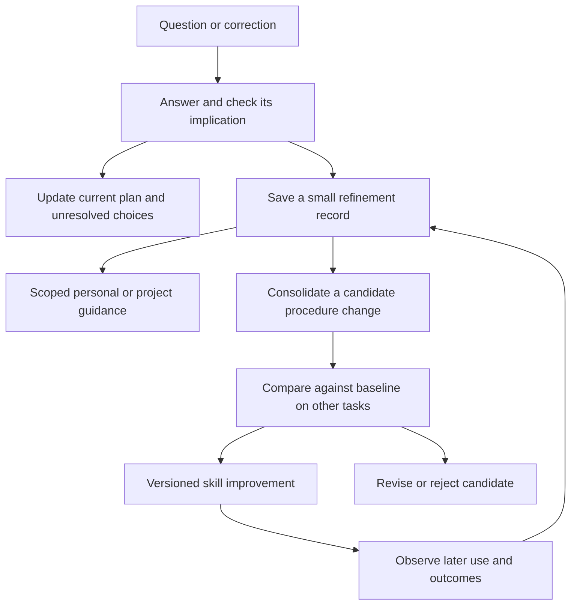

# Learning from planning conversations

Inspected **20 October 2026**. Status: **research and proposed extension**, not implemented. Grounded-plan remains v0.6.3. [Snapshot manifest and probe results](conversation-learning-sources.json).

## Recommendation

Treat meaningful follow-up questions as inputs to the current plan. Save the resulting clarification, correction, recommendation, or unresolved choice without requiring a separate “update the plan” request.

Learn at three different scopes:

| Scope | What changes | When |
|---|---|---|
| Current plan | Explanation, evidence, constraints, alternatives, recommendation, open decisions | During the conversation |
| Personal or project guidance | A preference or convention, with its scope and source | When supported by an explicit preference or sufficiently clear evidence |
| Reusable planning procedure | A small improvement to how future plans are produced | After evaluating a candidate against other cases |

Start inside the existing skill and user-wide library. Add host hooks only when reliable turn capture is needed; use a search optimizer only after useful evaluations exist. This is a design recommendation, not a measured cost or quality ranking.

## Current approaches

Costs describe additional model work, not dollar estimates.

| Approach | Useful mechanism | Fit and limitation | Cost tendency |
|---|---|---|---|
| Native memory | Claude Code saves corrections and preferences as repository-scoped notes, shared across worktrees. | Useful personalization; it does not by itself reconcile a canonical plan or validate a skill revision. [Official docs](https://code.claude.com/docs/en/memory) | Small starting overhead; capture remains model-selected |
| ECC continuous-learning-v2 | Hook observations become atomic, scoped “instincts”; commands cluster and promote them. | Borrow scoped evidence and incremental lessons. The inspected observation path records tool events, not a complete user/assistant exchange. A tool-free planning discussion can escape this path. [Skill](https://github.com/affaan-m/ECC/blob/6f1881aeafa3c48f7b603cc4be4b2e4e70daad59/skills/continuous-learning-v2/SKILL.md), [capture code](https://github.com/affaan-m/ECC/blob/6f1881aeafa3c48f7b603cc4be4b2e4e70daad59/skills/continuous-learning-v2/hooks/observe.sh#L215) | Cheap capture plus optional background analysis |
| Hermes core | Post-response reviews can update memory and skills; mutation history supports inspection and rollback. | Closest integrated runtime example. Cadence is conditional; automatic reflection is neither free nor evidence that its proposed lesson is correct. [Finalizer](https://github.com/NousResearch/hermes-agent/blob/bd3cbe91a90097f9804f16ea5c1768f5cbaaf0b7/agent/turn_finalizer.py#L765), [review](https://github.com/NousResearch/hermes-agent/blob/bd3cbe91a90097f9804f16ea5c1768f5cbaaf0b7/agent/background_review.py), [ledger](https://github.com/NousResearch/hermes-agent/blob/bd3cbe91a90097f9804f16ea5c1768f5cbaaf0b7/tools/skill_ledger.py) | Additional review turns; configurable cadence and input budget |
| Letta dreaming | Background conversations consolidate lessons into versioned memory; optional second-pass agent review. | Useful separation of active work from consolidation. Requires its runtime; memory review is not a task-quality test. [Official docs](https://docs.letta.com/configuration/memory) | Background pass, plus another if review is enabled |
| LangMem | Conversation trajectories, comments, and revisions inform prompt optimization; separate memory utilities handle extraction. | Closest small library primitive for converting Q&A into instruction changes. Its optimizer returns revised text; adoption and evaluation remain integration work. [Guide](https://github.com/langchain-ai/langmem/blob/48e3c11f5bb527282c7d5339c6a87a0b35abccfc/docs/docs/guides/optimize_memory_prompt.md), [implementation](https://github.com/langchain-ai/langmem/blob/48e3c11f5bb527282c7d5339c6a87a0b35abccfc/src/langmem/prompts/optimization.py) | Single-call mode available; reflection modes use more calls |
| ACE | Generate, reflect, curate a playbook with identifiable entries and feedback counters. | Borrow targeted changes and provenance. The inspected official operation applier implements additions; update, merge, and delete are TODOs. It is not a complete correction store to adopt unchanged. [Curator](https://github.com/ace-agent/ace/blob/82709de050e1db6e6ef2f07bcb0393560b94992a/ace/core/curator.py), [operation applier](https://github.com/ace-agent/ace/blob/82709de050e1db6e6ef2f07bcb0393560b94992a/playbook_utils.py#L96) | Reflection and curation calls |
| GEPA / GSkill | Run tasks with candidate skills, inspect feedback, and select improved variants. | Stronger promotion mechanism when evaluations are meaningful. Coding tasks with executable tests are easier to score than open-ended plans. [Author explanation](https://gepa-ai.github.io/gepa/blog/2026/02/18/automatically-learning-skills-for-coding-agents/) | Highest starting cost: repeated task execution and evaluation |

None of the inspected components demonstrates this complete workflow for engineering, product, and research planning. A portable composition fits better than adopting a full agent runtime solely for this feature.

### Claims that need qualification

- **ECC:** the optional observer is disabled in the documented default. Its confidence and cross-project promotion thresholds are heuristics, not calibrated probabilities. Absence of a correction is weak evidence of success.
- **Hermes core:** prompts explicitly favor reusable procedures over incident diaries and duplicate rules. Its documentation also describes approval controls and review cost limits. These are useful mechanisms; their existence does not establish planning improvements. [Memory and review controls](https://github.com/NousResearch/hermes-agent/blob/bd3cbe91a90097f9804f16ea5c1768f5cbaaf0b7/website/docs/user-guide/features/memory.md).
- **Hermes self-evolution add-on:** distinct from core's background learning. Its README marks continuous automation and code evolution as planned. The inspected skill optimizer uses keyword overlap for optimization and holdout scoring. A narrow probe scored “preserve unresolved decisions” and its negation equally at 1.0. This invalidates that metric as a sufficient planning-quality gate; it is not a full optimizer benchmark. [README](https://github.com/NousResearch/hermes-agent-self-evolution/blob/0a929e3aa20e15cf04dc7c28492a7d41a5139125/README.md), [metric](https://github.com/NousResearch/hermes-agent-self-evolution/blob/0a929e3aa20e15cf04dc7c28492a7d41a5139125/evolution/core/fitness.py#L107), [optimizer](https://github.com/NousResearch/hermes-agent-self-evolution/blob/0a929e3aa20e15cf04dc7c28492a7d41a5139125/evolution/skills/evolve_skill.py#L138).

## What a question should change

Capture its consequence, not just its wording.

| Signal | Update to the plan | Possible reusable lesson |
|---|---|---|
| “What does this component mean?” | Explain its role plainly; add an example if useful | Explain unfamiliar central concepts when introduced |
| Challenge to a new subsystem | Check reuse; state the tradeoff or revise the recommendation | Explain integration and why existing infrastructure is insufficient |
| Explicit constraint or correction | Update affected scope, diagram, delivery, and open decisions | Keep task-specific decisions local |
| Speculative alternative | Investigate or preserve it as an option | No preference inferred merely from asking |
| Explicit presentation preference | Apply it to the current brief | Store scoped personal guidance |
| Answer with no planning consequence | Answer normally | Usually nothing to save |

A changed recommendation can be saved as **proposed**. A user's question does not approve it. Distinguish agent reasoning, observed evidence, and user decisions. One clear preference can be enough to personalize; recurring questions alone do not establish a universal rule.

During active plan authoring, reconcile affected sections after each meaningful exchange. Keep the current brief coherent and the dated change trace compact. Review-only work and artifacts owned by another session retain their existing edit boundaries.

## Proposed learning loop

**Capture:** retain the source turn, plan and skill version, issue revealed, resulting change, scope, and status. Store a short evidence excerpt only when needed; link the private conversation rather than copying a transcript into the plan. Preserve superseded decisions.

**Consolidate:** at a meaningful checkpoint, combine related observations and inspect contrary examples. First check whether the existing skill already instructs the desired behavior. A missed save needs better reconciliation or host support; repeating the same instruction may only enlarge the skill.

**Improve:** revise the smallest relevant instruction. Personal preferences stay in private guidance unless they support a broadly useful procedure. Avoid producing a new mandatory section or rule for every question.

**Evaluate:** compare baseline and candidate on held-out engineering, product, and research cases. Include clarification, rejection, unresolved alternatives, changed constraints, and a case where no edit is appropriate. Split by task/conversation, not individual turns from the same dialogue.

Check factual and decision preservation, coherence across affected sections, unnecessary detail, unsupported commitments, and whether the result is easier to use. Use concrete assertions where possible and comparative judgment for readability. Agreement from an evaluator is not evidence of factual correctness. Track later corrections and actual outcomes; fewer questions alone is not a success metric.

## Storage and automatic capture

Keep the existing user-wide library. Initially, a dated refinement entry in the matched record plus a small private learning index is enough. Separate user preferences from candidate procedural lessons; keep source links, applicability, contradictory evidence, evaluation results, and supersession discoverable.

The public skill should contain the reusable procedure. Private conversation details, learned preferences, and examples remain outside the public repository. A larger journal or database is justified only by actual volume or coordination needs.

There are two levels of automation:

1. **Skill instructions:** the active planner updates its artifact and saves useful refinement without a separate user request. This reuses the conversation context and needs no mandatory extra model call. It remains dependent on the host loading the skill and the model performing the write.
2. **Host adapter:** prompt/turn hooks capture eligible planning exchanges and check whether their consequences were reconciled. Store a processing cursor and stable plan identity, handle repeated events and interrupted turns, and reconcile against the current artifact revision. Hooks improve capture coverage; they do not guarantee interpretation or successful persistence.

Codex documents `UserPromptSubmit`, `Stop`, and related lifecycle events. Its transcript pointer can be null, and the transcript format is explicitly unstable. Claude Code exposes prompt and turn-end hooks with transcript context. Separate adapters and smoke tests are needed; the current skill symlinks do not install them. These are documented capabilities, not verified installations on this machine. [Codex hooks](https://learn.chatgpt.com/docs/hooks), [Claude Code hooks](https://code.claude.com/docs/en/hooks).

## Cheapest useful rollout

- **First:** conversation reconciliation, scoped capture, and selective reuse in the existing skill/library.
- **Then:** bounded consolidation and a small regression set before promoting general lessons. Capture may be frequent; expensive reflection need not be.
- **If misses persist:** add host hooks with no-model capture and selective processing.
- **If evaluation proves valuable:** consider LangMem for candidate generation or GEPA for searching multiple candidates.

Once enabled, routine plan refinement and supported personal guidance need no repeated permission prompt. General skill changes should be versioned, evaluated, and reversible. Remote publication continues to require explicit approval under repository policy.

## Verification and limits

Inspected selected source paths at five pinned repository revisions and primary documentation for native memory, dreaming, hooks, and evaluated skill learning. No upstream runtime or model optimization was installed or executed.

Two standard-library probes executed only selected pure functions extracted with Python AST:

- Hermes add-on: positive and negated outputs both scored 1.0.
- ACE: `UPDATE` and `DELETE` operations left an existing playbook entry unchanged.

The manifest records source hashes and results. These checks substantiate narrow implementation limits, not comparative performance. A private planning example was also inspected; its details remain outside this public document. Cost savings, host compatibility, and longitudinal planning improvements remain unmeasured.
