# Signalbox background suggestions

Reuse the TypeScript service, SQLite scheduler, structured-model gateway, review panel and outbox. Add one background-evidence job handler and a host-controlled read surface. The shared inbox is the first delivery; repository activity and customer feedback use the same reasoning path with source-specific evidence and permissions. Every reviewable draft shows a conservative delivery-cost estimate separately from the actual investigation spend that produced it. Source deletion withdraws dependent pending drafts and invalidates their approvals.

The intended result is a useful, reviewable next step—or an explained decision to stay quiet—based on new evidence and the work already under way. Only an individual approved draft can enter existing delivery machinery. This plan proposes the design; implementation, model quality and operating capacity are untested. Outcomes are pending.

## Why this runtime

The supplied gateway already supports typed decisions, mediated reads and per-call cost reservation. Its missing caller loop is bounded work directly needed here. The separate agent runtime would require new usage admission controls and restriction of its shell, messaging and persistent sessions. Its broader capabilities do not help this first capability enough to justify that integration.

Use the same maintained domain instructions with the gateway. Keep source content in evidence fields, never in the instruction authority. Reconsider the general runtime only if bounded, read-only investigations demonstrably cannot produce useful suggestions and its admission and permission controls have been established. Doing nothing avoids cost but cannot deliver the requested capability; building separate reasoning services for each source creates unnecessary duplication.

## Evidence to decision to delivery

```mermaid
flowchart LR
    A[Repository, inbox, feedback adapters] --> B[Atomic evidence intake and work queue]
    B --> C[Background handler with leased work]
    C --> D[Host-authorized context reads]
    D --> E[Bounded gateway tool loop]
    E --> F[Durable quiet, deferred, or candidate decision]
    F -->|Candidate| J[Delivery adapter cost estimate]
    J --> G[Review panel with separate cost figures]
    G -->|Approve exact draft and cost ceiling| H[Existing outbox with fresh access and source checks]
    H --> I[Existing delivery machinery]
```

The diagram shows the main investigation and draft path; deletion invalidation can interrupt draft creation, approval or queued delivery. The adapters, scheduler, gateway, connection-scoped APIs, panel and outbox exist. The supplied delivery adapter exposes a conservative per-message estimate independently of model usage, and all source adapters can report deletion or absence on refresh. The external-evidence handler, its tool loop, durable work/decision contracts and evidence-aware checks are proposed additions. The diagram is editable but has not been rendered.

**Intake owns delivery deduplication and durable scheduling.** In one SQLite transaction, insert the source delivery under its unique `(source ID, delivery ID)`, record its resource/revision/content reference and disclosure scope, associate it with a work item, and mark that item due. Deletion intake instead applies the immediate withdrawal transaction described below; it does not wait for a reasoning job. An exact retry changes nothing. Adapter authentication establishes origin, not authority to issue instructions or permission to disclose content. Store content references by default; any cached text carries the same access restrictions as its source.

**The work record groups evidence without inventing a correlation service.** Prefer an existing task identity when a task record explicitly links the source resource; otherwise use the project and source's stable resource identity. Project mappings keyed by resource ID and current directory roles are authoritative. Search summaries and learned associations only suggest candidates to verify. Explicit resource links can join inbox, repository and feedback evidence to the same task. Fuzzy similarity alone cannot merge work or justify revealing one source to another audience. Conflicting mappings become an inspectable unresolved decision; unlinked evidence can still be assessed in its own resource work item.

Repository and inbox revisions identify evidence changes. Revision strings are not assumed to sort chronologically: the handler reads the relevant current source state and records the content actually used, with its revision when available and a host-computed digest. An old notification can therefore trigger a check without making old content the current truth. Feedback submissions are immutable evidence keyed by stable submission ID. A conflicting payload under the same submission identity is recorded for inspection, not silently treated as an authorized revision. Deletion is a lifecycle change for all three sources, including otherwise immutable feedback submissions.

**The handler builds a small, current context.** Start from the triggering resource and authoritative project mapping; fetch linked task states, relevant conversations and prior decisions for the work item. The model can request additional reads through typed tools for source content, project metadata, directory roles, conversations and tasks. Each tool resolves a known connection and checks access as that connection principal. A model-supplied resource ID is a lookup request, never proof of access. The model has no shell, mutation, messaging or task-creation tools.

Return bounded content plus host-generated evidence handles, stable source-item identities, source-state generations, provenance and authorization/disclosure labels. Record all items used as dependencies of the candidate, including retrieved context that the model does not cite. Denied or unknown access returns a structured unavailable result without protected text. Recheck access on every read, including cache reads. Source errors remain distinguishable from evidence that the work needs no action. Source-specific retrieval lives behind these tools; the reasoning loop and domain instructions are shared by all adapters.

**The gateway decides; the host validates and persists.** Its typed result is one of:

| Result | Required meaning | Durable effect |
|---|---|---|
| `quiet` | Evidence does not justify a distinct useful next step, with a reason such as already handled | Record the decision and input snapshot; complete this generation |
| `defer` | A named missing fact, temporary failure or conflict prevents a sound decision | Record reason, due time or prerequisite, and bounded retry state |
| `draft` | A proposed next step, rationale, evidence handles and candidate audience | Validate dependencies and obtain the delivery estimate, then store a reviewable draft; create no external work |

The host verifies the output schema, evidence handles, task/resource references and permitted destination. The model can propose an audience; current project mapping, role assignments and disclosure policy determine whether that audience is eligible. Unresolvable ownership or audience ambiguity becomes `defer`, not a guessed recipient. An approved draft sends only through the existing outbox.

## Permissions survive synthesis

A run records every protected item placed into model context, including tool results. Conservatively, its result inherits all those disclosure restrictions, even if the model cites only some items. A model cannot lower the restriction by omitting a citation or paraphrasing private evidence. Mixed-source reasoning may therefore produce a draft visible only to a narrow audience. If the proposed destination fails a check, the host can offer an eligible narrower audience only when authoritative ownership and policy support it; otherwise the decision is deferred. A broader-audience draft requires a fresh run whose inputs are all eligible for that audience.

Panel access checks the current reviewer's permission to the draft and its evidence before returning either. Approval binds an exact draft version, content hash, destination audience and the displayed delivery-cost ceiling in its currency. Editing content or changing the audience requires renewed individual approval. Recheck current source existence, access and disclosure eligibility at approval and again immediately before outbox delivery. Deny or unknown blocks delivery, including when access was revoked after approval; record a restricted status and notify through the panel's existing permitted status surface. The outbox must carry evidence handles and scope dependencies, extending its current chat-evidence contract. Protected text is excluded from ordinary job logs and queue listings; evidence inspection itself is access-controlled.

Quiet-hours and approval policy checks remain host policy at their existing gates. Source-deletion withdrawal is an internal invalidation and runs immediately even during quiet hours. The new handler uses those gates and schedules deferred work for the next eligible time. It cannot instruct the model or outbox to bypass them.

## Deletion withdraws dependent drafts

A candidate or draft depends on every source item supplied to its investigation, not just the citations selected for display. Persist those dependency rows so deletion of a private context item cannot leave its conclusions in a draft with apparently surviving citations.

On an authenticated deletion event or a refresh that positively reports the item deleted/absent, atomically mark that source item deleted, advance its source-state generation, withdraw all dependent unapproved drafts and approved-but-unsent drafts, invalidate their approvals, and cancel queued or retryable outbox entries. Retain an access-controlled withdrawal record with the reason and identifiers; the active review panel removes the draft from approvable work and shows its withdrawn status. Do not silently remove the citation and keep the text. Any replacement must come from a fresh investigation using surviving evidence and receive a new individual approval.

Each run captures dependency generations. Before committing a candidate or draft, its transaction verifies that every dependency still exists and its generation matches. This shares serialization with deletion intake: deletion before commit rejects the late worker result; deletion after commit withdraws it. Cancellation can save remaining investigation cost, but the generation check is what prevents a finishing or restarted worker from recreating withdrawn work. Old source notifications and transport retries cannot clear a deletion marker.

Before approval, refresh all source-item dependencies, then atomically check their recorded generations and the draft's current state while binding approval. Before dispatch, do the same refresh and transaction check while acquiring the outbox send lease. A processed deletion therefore wins against later local approval/send authorization. Confirmed absence triggers withdrawal. A timeout, denied access or unknown existence blocks approval/dispatch with an inspectable reason rather than treating the source as present or inventing a deletion.

If deletion arrives while delivery status is uncertain, cancel all further send attempts and use the existing provider reconciliation only to discover whether the original send already occurred. An unsent item becomes withdrawn; an already delivered item remains a historical delivery marked with the later deletion. Retraction of delivered messages is outside the requested pending-draft rule. The supplied interfaces leave one external concurrency limit, D1 below; local transactions cannot make an external source refresh atomic with a provider send.

## Three identities prevent different kinds of repetition

1. **Delivery identity** suppresses transport retries at intake. It does not suppress a genuinely new source revision.
2. **Evaluation identity** combines the work identity and the normalized input snapshot: evidence revisions/digests and source-state generations, relevant current task/conversation state and policy/instruction version. Persisting a result under this identity is unique, so a lease retry cannot create another decision or draft for that same snapshot. A retry may repeat a bounded model call after a crash; duplicate model cost and duplicate user-visible work are separate concerns.
3. **Suggestion identity** uses a structured action category and stable target resource alongside the work identity; it also records supporting evidence and draft/delivery disposition. The host checks this key for exact matches. The model receives prior dispositions and current task state to assess equivalent actions expressed differently; those semantic judgments remain a measured quality risk. Before accepting a new draft, compare it with current task state, active drafts and delivered suggestions. An active task or an equivalent pending/sent suggestion normally yields `quiet`. A material changed condition can justify a later draft; the decision must state what changed and why existing handling is insufficient. A new timestamp or revision alone is insufficient.

Keep at most one active draft for an equivalent action on a work item. If new evidence materially changes an unapproved draft, supersede it visibly rather than appending a duplicate. Approval and supersession race through one transaction. An approved but unsent obsolete draft is held in the outbox for review, not silently edited. Delivered suggestions remain history and do not prevent a materially different later next step. Rejected drafts retain the reason; unchanged evidence must not continually recreate them. At approval and immediately before delivery, re-read linked task state and check competing approved/sent suggestions. Compare the current relevant source versions/digests with the draft basis. If a dependency is deleted or confirmed absent, withdraw it under the deletion contract. If its basis has otherwise changed, hold it for reevaluation and renewed review; if the action is already handled, invalidate it visibly. This closes the gap between a valid earlier draft and current work. Explicit links allow cross-source suppression, while unresolved cross-source similarity remains a quality limitation to measure rather than grounds for unsafe merging.

## Durable state, recovery and cost

Maintain evidence and source-state generations, work generations, runs, decisions, draft dependency/estimate records and draft/outbox references in SQLite. A work generation captures the input being evaluated; evidence arriving during a run marks a newer generation due. Completing the earlier run cannot clear newer pending work. Commit the run result, its decision, draft and processed-generation marker atomically.

Use existing expiring leases with a lease token checked on result commit. An expired worker cannot commit after a replacement has acquired the work. If a worker crashes before commit, the lease expires and the same generation is eligible again. If it crashes after commit, unique evaluation identity returns the persisted outcome. Separate approval-to-outbox creation is atomic and unique per approved draft version. For uncertain sends, retain the existing provider reconciliation before retrying; never regenerate a recommendation as a delivery retry.

Use the gateway's existing admission budget for every model call, including retries. Reserve before calling and settle reported usage afterward. Persist reservations against the run; if usage is uncertain after a crash, retain the conservative charge until it can be reconciled rather than releasing it and overspending. Stop admitting new runs when the configured gateway budget refuses them. Queue cost deferrals visibly with a next eligible time; they are not quiet decisions.

**Show two separate costs on every reviewable draft.** After content and audience validation, ask the existing delivery adapter for its conservative per-message estimate. Store the amount, currency, estimate time and adapter-supplied basis against the draft content hash and destination. The model does not invent this amount. If the estimator fails, retain a deferred candidate with an inspectable estimation failure; do not publish an approvable draft without the required estimate.

The panel presents “Estimated delivery cost” as that conservative amount and “Actual investigation spend” as settled gateway usage across all attempts of the evaluation that produced the draft. Link spend to the evaluation ID rather than charging it again each time the panel opens. Show any unsettled reservation separately as pending/unknown usage; a reserved ceiling is not actual spend. Withdrawal leaves investigation spend in the ledger and does not claim that the estimated delivery cost was incurred. Do not add the two figures or describe the estimate as actual delivery billing.

Refresh the delivery estimate at approval and immediately before dispatch. Content/destination must still match the approved draft, and the refreshed estimate must be within the approved displayed ceiling in the same currency. An increase or currency change returns the item to review with the new estimate; equality or a decrease stays within the individual's approved ceiling. Estimation failure defers dispatch. These checks supplement the existing usage budget and approval policy; they do not grant automatic approval or introduce a second delivery service.

Proposed conservative pilot limits are four model calls, eight tool calls, 64 KiB of total tool text, 8 KiB of decision output and 90 seconds of active run time, with at most three processing attempts. Call and output budgets belong to the durable evaluation and are not reset by a worker crash. These are operational starting choices, not measured capacity. If the budget is exhausted before a valid decision, persist an inspectable limit result. Transient infrastructure failures use bounded backoff; permission denial, conflicting identity and invalid output are separately classified. Exhausted attempts leave a visible failed item with a reason. An authorized operator may replay it under fresh admission; replaying the same snapshot still cannot create a duplicate draft.

Start with one active background evaluation and coalesce pending evidence per work item. Existing foreground work retains scheduling priority. Record queue age, coalescing, attempts, failure/deferral reason, calls, reserved/settled investigation cost, estimated delivery cost, quiet reason, draft review/withdrawal outcome and outbox status. This provides a baseline before choosing production throughput. No separate long-running reasoning session or new service is needed.

## Delivery sequence and acceptance

| Increment | Result and dependency | Observable acceptance |
|---|---|---|
| Shared-inbox path through review and delivery guards | Extend evidence/decision persistence, dependency generations, handler/tool loop, host-checked reads, cost presentation and panel/outbox guards together. Reuse existing transport, estimation and delivery adapters. | A restricted inbox message becomes a quiet decision or a draft visible only to eligible reviewers/audiences. The draft shows separate estimated delivery cost and actual investigation spend. Only an eligible person's approval of that exact draft permits the outbox path. Duplicate events and restarts create no duplicate work. Deletion before/after draft commit and after approval withdraws dependent pending drafts; denied/unknown source checks block dispatch. Validate the locally enforceable guards while retaining D1 as a full-delivery acceptance gate. |
| Small shared-inbox pilot | Depends on the first path, permission/cost/deletion checks and resolution of D1 for the required delivery guarantee. Separately authorize live source setup and model runs; neither is part of this planning request. | Review a bounded sample for usefulness, redundancy, evidence support, audience correctness and clarity of the two costs. Record quiet/deferred/failed/withdrawn cases as well as drafts. Any permission leak, approval bypass or delivery that violates the deletion contract stops the pilot. Choose usefulness and capacity targets from this baseline before production expansion. |
| Repository and feedback integration | Reuse the same handler and tool loop; add source read normalization and evidence fixtures, plus explicit resource-link correlation where available. | Repository revisions and distinct feedback submissions can justify later useful action; exact retries remain deduplicated. An explicitly linked repository/inbox pair avoids an already active task suggestion and inherits the narrow inbox restriction. Deletion of any dependency withdraws a draft across source boundaries. All drafts retain separate costs and individual approval. No additional reasoning service is introduced. |
| Operating capacity | Depends on measured arrivals, investigation cost, delivery estimates, latency and review outcomes. | Set a production load target and budget, then demonstrate sustainable queue age, restart recovery, prompt withdrawal and reviewer workload under that target. Tune concurrency/limits only with those results. |

The first increment is a narrow end-to-end shared-inbox capability, including its stricter disclosure boundary and all current draft requirements. Intake alone is a prerequisite, not a useful first delivery. Repository activity and feedback remain part of the general design and follow in source integration.

Use the existing `npm test` suite, deterministic transport/gateway/outbox fakes and persisted-database worker restart fixture. Add coverage for the contracts above rather than a separate testing framework. In particular, inject deletion between refresh and local commit, during worker completion, after approval and before retry; check restart persistence of withdrawal and rejection of stale approval tokens. Fake the estimate independently of gateway usage, including a cost increase, estimator failure and unsettled model usage. These are planned checks, not results from this exercise; a deterministic local fake cannot establish atomicity between two external providers.

## Readiness and reasoned walkthroughs

- An inbox delivery arrives twice: intake uniqueness produces one work update. A worker crashes after saving its draft: the next worker sees the committed evaluation and the panel still contains one draft with the same evaluation spend attribution.
- A new revision arrives while the earlier generation runs: it remains pending. An already handled action is suppressed; a material new blocker can justify a later draft. Existing quiet-hours and individual approval gates still apply.
- A repository event and an inbox message link to the same task: the handler considers both, but the draft inherits the inbox restriction. A public project-channel destination fails disclosure validation. Deleting either dependency withdraws the pending draft, including one approved for the narrower audience.
- A deletion arrives after the worker prepares a candidate but before it commits: the changed dependency generation rejects the commit. If it arrives after draft persistence or approval, withdrawal and outbox cancellation are atomic. A late worker cannot restore the draft.
- A deletion event is delayed: the required refresh can discover absence at approval or dispatch and withdraw the draft before either local gate succeeds. If refresh cannot determine existence, the gate blocks.
- The panel shows investigation usage already settled by the gateway and a separate delivery estimate from the adapter. If the delivery estimate later exceeds the approved ceiling, the draft returns for individual approval of the new ceiling. If a source is deleted instead, withdrawal takes precedence; previously spent investigation cost remains visible in the ledger.
- Source access is revoked after approval: the delivery-time check holds the outbox item. Admission refusal, tool limits and exhausted retries produce distinct persisted reasons and no delivery. An uncertain send is reconciled before any eligible retry; withdrawal prohibits a new send.

These are reasoned walkthroughs, not executed tests. The supplied facts support the reusable capabilities and the current plan supplies the new contracts. Usefulness, false suppression from imperfect cross-source matching, cost and capacity remain empirical qualification gaps.

**D1 — deletion ordering across external systems.** The requirement covers deletion before approval or send. The proposed transactions enforce it for every deletion already processed or found by the mandatory refresh. The supplied adapters do not establish a way to prevent a source deletion occurring after the final refresh while an external send is in flight, or to observe it before a concurrent approval. Refresh plus a local transaction cannot prove the stronger ordering guarantee.

Preserve that requirement as a delivery-readiness gate. The necessary bounded observation is an adapter/provider contract check for source-version conditional authorization, a source-side validity lease coordinated with deletion, or equivalent ordering through the actual delivery commit. Passing means a source deletion that precedes approval or delivery deterministically rejects that operation, including the concurrent boundary; ordinary periodic refresh is insufficient. If no such capability exists, only an explicitly accepted narrower guarantee could unblock full delivery. No capability is inferred and no scope change is assumed here.

The shared-inbox investigation/review path and the specified local deletion guards are ready to implement and test independently. Full approval/delivery qualification remains unresolved at D1, in addition to the planned live usefulness and capacity checks. The next authorized phase would implement the shared-inbox path and establish the external ordering contract before declaring its delivery acceptance met. Outcomes remain pending; no live setup, model runs or implementation were performed for this plan.
