# Signalbox background suggestions

Reuse the TypeScript service, SQLite scheduler, structured-model gateway, review panel and outbox. Add one background-evidence job handler and a host-controlled read surface. Repository activity is the first delivery; inbox and feedback use the same reasoning path with source-specific evidence and permissions.

The intended result is a useful, reviewable next step—or an explained decision to stay quiet—based on new evidence and the work already under way. Only an individual approved draft can enter existing delivery machinery. This plan proposes the design; implementation, model quality and operating capacity are untested. Outcomes are pending.

## Why this runtime

The supplied gateway already supports typed decisions, mediated reads and per-call cost reservation. Its missing caller loop is bounded work directly needed here. The separate agent runtime would require new usage admission controls and restriction of its shell, messaging and persistent sessions. Its broader capabilities do not help this first capability enough to justify that integration.

Use the same maintained domain instructions with the gateway. Keep source content in evidence fields, never in the instruction authority. Reconsider the general runtime only if bounded, read-only investigations demonstrably cannot produce useful suggestions and its admission and permission controls have been established. Doing nothing avoids cost but cannot deliver the requested capability; building separate reasoning services for each source creates unnecessary duplication.

## Evidence to decision to delivery

```mermaid
flowchart LR
    A[Repository, inbox, feedback adapters] --> B[Atomic evidence intake and work queue]
    B --> C[Background handler with leased work]
    C --> D[Host-authorized context reads]
    D --> E[Bounded gateway tool loop]
    E --> F[Durable quiet, deferred, or draft decision]
    F --> G[Review panel]
    G -->|Approve exact draft| H[Existing outbox with fresh access checks]
    H --> I[Existing delivery machinery]
```

The adapters, scheduler, gateway, connection-scoped APIs, panel and outbox exist. The external-evidence handler, its tool loop, durable work/decision contracts and evidence-aware checks are proposed additions. The diagram is editable but has not been rendered.

**Intake owns delivery deduplication and durable scheduling.** In one SQLite transaction, insert the source delivery under its unique `(source ID, delivery ID)`, record its resource/revision/content reference and disclosure scope, associate it with a work item, and mark that item due. An exact retry changes nothing. Adapter authentication establishes origin, not authority to issue instructions or permission to disclose content. Store content references by default; any cached text carries the same access restrictions as its source.

**The work record groups evidence without inventing a correlation service.** Prefer an existing task identity when a task record explicitly links the source resource; otherwise use the project and source's stable resource identity. Project mappings keyed by resource ID and current directory roles are authoritative. Search summaries and learned associations only suggest candidates to verify. Explicit resource links can join inbox, repository and feedback evidence to the same task. Fuzzy similarity alone cannot merge work or justify revealing one source to another audience. Conflicting mappings become an inspectable unresolved decision; unlinked evidence can still be assessed in its own resource work item.

Repository and inbox revisions identify evidence changes. Revision strings are not assumed to sort chronologically: the handler reads the relevant current source state and records the content actually used, with its revision when available and a host-computed digest. An old notification can therefore trigger a check without making old content the current truth. Feedback submissions are immutable evidence keyed by stable submission ID. A conflicting payload under the same submission identity is recorded for inspection, not silently treated as an authorized revision.

**The handler builds a small, current context.** Start from the triggering resource and authoritative project mapping; fetch linked task states, relevant conversations and prior decisions for the work item. The model can request additional reads through typed tools for source content, project metadata, directory roles, conversations and tasks. Each tool resolves a known connection and checks access as that connection principal. A model-supplied resource ID is a lookup request, never proof of access. The model has no shell, mutation, messaging or task-creation tools.

Return bounded content plus host-generated evidence handles, provenance and authorization/disclosure labels. Denied or unknown access returns a structured unavailable result without protected text. Recheck access on every read, including cache reads. Source errors remain distinguishable from evidence that the work needs no action. Source-specific retrieval lives behind these tools; the reasoning loop and domain instructions are shared by all adapters.

**The gateway decides; the host validates and persists.** Its typed result is one of:

| Result | Required meaning | Durable effect |
|---|---|---|
| `quiet` | Evidence does not justify a distinct useful next step, with a reason such as already handled | Record the decision and input snapshot; complete this generation |
| `defer` | A named missing fact, temporary failure or conflict prevents a sound decision | Record reason, due time or prerequisite, and bounded retry state |
| `draft` | A proposed next step, rationale, evidence handles and candidate audience | Validate and store a reviewable draft; create no external work |

The host verifies the output schema, evidence handles, task/resource references and permitted destination. The model can propose an audience; current project mapping, role assignments and disclosure policy determine whether that audience is eligible. Unresolvable ownership or audience ambiguity becomes `defer`, not a guessed recipient. An approved draft sends only through the existing outbox.

## Permissions survive synthesis

A run records every protected item placed into model context, including tool results. Conservatively, its result inherits all those disclosure restrictions, even if the model cites only some items. A model cannot lower the restriction by omitting a citation or paraphrasing private evidence. Mixed-source reasoning may therefore produce a draft visible only to a narrow audience. If the proposed destination fails a check, the host can offer an eligible narrower audience only when authoritative ownership and policy support it; otherwise the decision is deferred. A broader-audience draft requires a fresh run whose inputs are all eligible for that audience.

Panel access checks the current reviewer's permission to the draft and its evidence before returning either. Approval binds an exact draft version, content hash and destination audience. Editing content or changing the audience requires renewed approval. Recheck current source access and disclosure eligibility at approval and again immediately before outbox delivery. Deny or unknown blocks delivery, including when access was revoked after approval; record a restricted status and notify through the panel's existing permitted status surface. The outbox must carry evidence handles and scope dependencies, extending its current chat-evidence contract. Protected text is excluded from ordinary job logs and queue listings; evidence inspection itself is access-controlled.

Quiet-hours and approval policy checks remain host policy at their existing gates. The new handler uses those gates and schedules deferred work for the next eligible time. It cannot instruct the model or outbox to bypass them.

## Three identities prevent different kinds of repetition

1. **Delivery identity** suppresses transport retries at intake. It does not suppress a genuinely new source revision.
2. **Evaluation identity** combines the work identity and the normalized input snapshot: evidence revisions/digests, relevant current task/conversation state and policy/instruction version. Persisting a result under this identity is unique, so a lease retry cannot create another decision or draft for that same snapshot. A retry may repeat a bounded model call after a crash; duplicate model cost and duplicate user-visible work are separate concerns.
3. **Suggestion identity** uses a structured action category and stable target resource alongside the work identity; it also records supporting evidence and draft/delivery disposition. The host checks this key for exact matches. The model receives prior dispositions and current task state to assess equivalent actions expressed differently; those semantic judgments remain a measured quality risk. Before accepting a new draft, compare it with current task state, active drafts and delivered suggestions. An active task or an equivalent pending/sent suggestion normally yields `quiet`. A material changed condition can justify a later draft; the decision must state what changed and why existing handling is insufficient. A new timestamp or revision alone is insufficient.

Keep at most one active draft for an equivalent action on a work item. If new evidence materially changes an unapproved draft, supersede it visibly rather than appending a duplicate. Approval and supersession race through one transaction. An approved but unsent obsolete draft is held in the outbox for review, not silently edited. Delivered suggestions remain history and do not prevent a materially different later next step. Rejected drafts retain the reason; unchanged evidence must not continually recreate them. At approval and immediately before delivery, re-read linked task state and check competing approved/sent suggestions. Compare the current relevant source versions/digests with the draft basis. If its basis has changed, hold it for reevaluation and renewed review; if the action is already handled, invalidate it visibly. This closes the gap between a valid earlier draft and current work. Explicit links allow cross-source suppression, while unresolved cross-source similarity remains a quality limitation to measure rather than grounds for unsafe merging.

## Durable state, recovery and cost

Maintain evidence, work generations, runs, decisions and draft/outbox references in SQLite. A work generation captures the input being evaluated; evidence arriving during a run marks a newer generation due. Completing the earlier run cannot clear newer pending work. Commit the run result, its decision, draft and processed-generation marker atomically.

Use existing expiring leases with a lease token checked on result commit. An expired worker cannot commit after a replacement has acquired the work. If a worker crashes before commit, the lease expires and the same generation is eligible again. If it crashes after commit, unique evaluation identity returns the persisted outcome. Separate approval-to-outbox creation is atomic and unique per approved draft version. For uncertain sends, retain the existing provider reconciliation before retrying; never regenerate a recommendation as a delivery retry.

Use the gateway's existing admission budget for every model call, including retries. Reserve before calling and settle reported usage afterward. Persist reservations against the run; if usage is uncertain after a crash, retain the conservative charge until it can be reconciled rather than releasing it and overspending. Stop admitting new runs when the configured gateway budget refuses them. Queue cost deferrals visibly with a next eligible time; they are not quiet decisions.

Proposed conservative pilot limits are four model calls, eight tool calls, 64 KiB of total tool text, 8 KiB of decision output and 90 seconds of active run time, with at most three processing attempts. Call and output budgets belong to the durable evaluation and are not reset by a worker crash. These are operational starting choices, not measured capacity. If the budget is exhausted before a valid decision, persist an inspectable limit result. Transient infrastructure failures use bounded backoff; permission denial, conflicting identity and invalid output are separately classified. Exhausted attempts leave a visible failed item with a reason. An authorized operator may replay it under fresh admission; replaying the same snapshot still cannot create a duplicate draft.

Start with one active background evaluation and coalesce pending evidence per work item. Existing foreground work retains scheduling priority. Record queue age, coalescing, attempts, failure/deferral reason, calls, reserved/settled cost, quiet reason, draft review outcome and outbox status. This provides a baseline before choosing production throughput. No separate long-running reasoning session or new service is needed.

## Delivery sequence and acceptance

| Increment | Result and dependency | Observable acceptance |
|---|---|---|
| Repository path through review and delivery | Extend evidence/decision persistence, implement the handler and bounded gateway loop, expose host-checked reads, and extend panel/outbox evidence checks together. Reuse existing transport and delivery adapters. | A repository event becomes a quiet decision or evidenced draft. An eligible person approves that exact draft and the existing outbox handles it. Deterministic fakes prove that nothing sends or creates a task without approval. Duplicate events, worker restart and denied/unknown access produce the specified durable results. |
| Small repository pilot | Depends on the complete first path and policy checks. Separately authorize live source setup and model runs; neither is part of this planning request. | Review a bounded sample for usefulness, redundancy, evidence support and audience correctness. Record all quiet/deferred/failed cases as well as drafts. Any permission leak or approval bypass stops the pilot. Choose acceptable usefulness and capacity targets from this baseline before production expansion. |
| Inbox and feedback integration | Reuse the same handler and tool loop; add source read normalization and evidence fixtures, plus explicit resource-link correlation where available. | A restricted inbox item stays restricted through context, panel and delivery; an explicitly linked repository/inbox pair avoids the same active task suggestion; repeated feedback submission is deduplicated while distinct submissions remain evidence. No additional reasoning service is introduced. |
| Operating capacity | Depends on measured arrivals, run cost, latency and review outcomes. | Set a production load target and budget, then demonstrate sustainable queue age, restart recovery and reviewer workload under that target. Tune concurrency/limits only with those results. |

The first increment is deliberately a narrow end-to-end repository capability. Intake alone is a prerequisite, not a useful first delivery. Inbox and feedback are part of the design even though their integration follows.

Use the existing `npm test` suite, deterministic transport/gateway/outbox fakes and persisted-database worker restart fixture. Add coverage for the contracts above rather than a separate testing framework. These are planned checks, not results from this exercise.

## Readiness and reasoned walkthroughs

- A repository delivery arrives twice: intake uniqueness produces one work update. A worker crashes after saving its draft: the next worker sees the committed evaluation and the panel still contains one draft.
- A new revision arrives while the earlier generation runs: it remains pending. If it merely repeats an already handled action, current task state suppresses a suggestion. If it introduces a material new blocker, a new evaluation can create a justified follow-up.
- A repository event and an inbox message link to the same task: the handler considers both, but the resulting draft inherits the inbox restriction. A public project-channel destination fails disclosure validation.
- Source access is revoked after approval: the delivery-time check holds the outbox item. Approval does not preserve access rights that no longer exist.
- Admission refuses a call, a tool exceeds its limit, or retries are exhausted: each yields a distinct persisted reason and no delivery. An uncertain provider send goes through existing reconciliation.

These are design walkthroughs, not executed integration tests. They support implementation readiness for the first repository path; they do not establish model usefulness or production readiness. The supplied source packet establishes the reusable capabilities, while this plan supplies the new contracts. No essential runtime or access decision is deferred to implementation. Material remaining uncertainty is empirical: usefulness, false suppression from imperfect cross-source matching, cost and capacity. The next action is to implement and validate the repository path, with outcomes pending and live qualification separately authorized.
