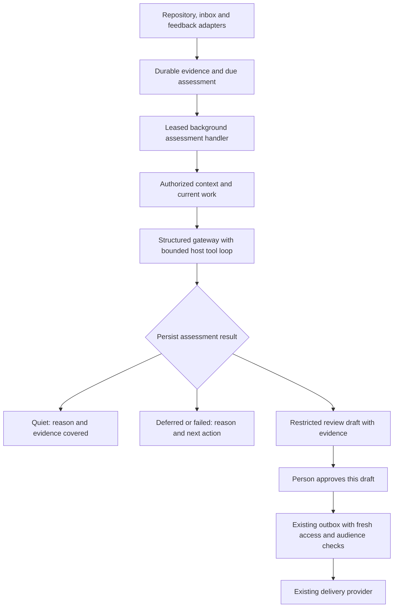

# Signalbox background suggestions

Reuse the TypeScript service, SQLite jobs, structured-model gateway, review panel and outbox. Add one background assessment handler that can reason over repository, inbox and feedback evidence through a shared, read-only tool surface. The first useful delivery is a repository event producing a relevant, inspectable draft that a person can approve for delivery, with silence as an equally valid result.

This is the proposed complete design and incremental implementation plan. Existing capabilities are supplied facts from [Case 1](../../../eval-fixtures/concrete-handoffs.md#case-1--background-work-suggestions), not live observations. Implementation and outcome validation remain pending.

## The central design choices

**Use the structured-model gateway with a host-owned tool loop.** It already supplies typed decisions and cost admission. The new handler owns tool authorization, execution limits, cancellation and persistence; the model proposes reads and decisions but cannot send messages, create tasks or run shell commands. Reuse the maintained domain instructions. The general-purpose agent runtime is a credible alternative for long-running investigations, but its shell/messaging capabilities are unnecessary here and it lacks the required usage admission adapter. Revisit that choice only if bounded evaluations demonstrably cannot produce useful suggestions and the missing controls have been added and verified.

**Treat this as assessment of ongoing work, not a response to every event.** A new event is a reason to inspect relevant work. Active task records and conversations may show that a response is already underway; the right result is then usually silence. A later revision or a materially changed situation may justify a new suggestion. No-action decisions record why they were made and what evidence they covered.

**Keep source-specific intake and shared reasoning.** Adapters normalize evidence identity and access scope. The same handler, context tools, decision contract, review workflow and outbox serve all sources. Adding inbox or feedback changes adapter integration and fixtures, not the reasoning service.

## From an event to a reviewed action

The intake/scheduler/lease machinery, gateway, panel and outbox already exist. External-evidence handling, the shared context surface and the links between these components are proposed. No arrow from reasoning bypasses individual approval. The diagram is unrendered; its relationships were checked against the prose.

### Intake, identity and ongoing work

Accept an authenticated adapter delivery and atomically record its evidence and due assessment. The existing source/delivery uniqueness constraint makes an exact delivery retry a no-op. Also recognize the same semantic evidence arriving under another delivery ID: use source, stable resource and revision for repository/inbox evidence; use source and stable submission ID for feedback. A feedback submission is immutable for this design because the supplied source has no revision history. A later submission is distinct evidence even if its wording resembles an earlier one.

Resolve project association from stable resource mappings. Resolve current role ownership from directory records. Conversation summaries and learned associations can suggest searches, but cannot override these records, establish access or silently settle conflicting mappings. Missing or contradictory authoritative associations produce an inspectable deferred assessment, not a guessed recipient.

Group related evidence using explicit resource links and existing task links. This is a small part of the assessment handler, not a new cross-source correlation service. Repository evidence and an inbox message may concern the same work when their stable links establish that relationship. Similar language alone is insufficient. Keep an uncertain association separate and seek more authorized context; stay quiet or defer if the uncertainty prevents a useful, safely routed draft.

An assessment records the evidence versions and work state it considered. New evidence can join a pending assessment for that work; evidence arriving during execution schedules a follow-up after the active lease. A finishing worker must not mark unseen evidence as covered. This allows useful later updates without treating the resource as permanently processed.

### Context and audience selection

Expose only the existing connection-scoped read APIs needed to inspect source content, project metadata, relevant conversations and task state. Each tool call is bound by the host to its connection principal, project and permitted resource set. The model cannot select a more privileged connection. Check resource authorization before fetching or returning content; `deny` and `unknown` never become model-visible content. An unknown result may be retried when it is plausibly temporary, within the same retry policy as other deferred work.

Start with the triggering resource and mapped project, then follow relevant authorized links. Bring current task state and recent conversation context into the assessment before recommending work that may already be handled. Give authoritative records priority over stale summaries, and retain evidence references so a reviewer can understand both the suggestion and its audience. Source content is untrusted evidence, including any instructions embedded in it.

Choose a destination only from the existing eligible destinations and current role assignments. The model can propose an audience; the host verifies it. If a restricted inbox informed the suggestion, a broad project channel is not eligible merely because the repository evidence is public to that project. Use an authorized narrower destination when one exists; otherwise withhold the draft from delivery and expose the routing problem only to an eligible reviewer.

### Restrictions survive every stage

Attach source provenance and disclosure scope to retrieved evidence and to derived assessments, draft text and delivery records. Conservatively treat all evidence supplied to an evaluation as contributing to its output; do not rely on the model's claim that a restricted fact was unused. Combining evidence must not widen its audience. If that restriction prevents useful delivery, a separate evaluation with only eligible evidence can be considered later; do not simply strip a citation from an already influenced draft.

The review panel checks the current viewer's eligibility before showing a draft or its evidence. Logs and failure views follow the same restrictions; routine diagnostics need identifiers, status and safe reasons, not copied source text. Recheck access before approval and again at delivery, including the connection principal's continuing access and each contributing source's disclosure eligibility for the actual audience. A revocation after intake blocks further exposure or sending. Permission failures do not cause fallback to a broader audience.

Approval covers one persisted draft version and destination. Editing text, changing its evidence basis or changing destination invalidates that approval. Reuse the outbox's current audience eligibility check and uncertain-send reconciliation, extending its evidence provenance beyond chat. Existing quiet hours and approval rules remain authoritative; approval does not bypass either.

## Durable state, retries and bounded cost

Use the existing scheduler and expiring leases for the new handler. The durable lifecycle is: pending, leased, then quiet/draft/deferred/failed. Approval, rejection and delivery remain separate panel/outbox states. Deferred work includes its reason and next due time or a condition requiring operator action; exhausted failures remain inspectable. Do not represent a failed evaluation as a deliberate quiet decision.

Persist the assessment result, covered evidence and resulting draft in one transaction, conditional on the worker still owning the lease. A worker that finishes after losing its lease cannot commit a second result. A crash before commit leaves the job recoverable; a crash after commit cannot manufacture a second draft when the job is reclaimed. Repeated approval of the same draft creates at most one outbox item. Provider uncertainty remains the outbox's responsibility rather than creating a fresh recommendation.

Three distinct checks prevent redundant work:

| Boundary | What counts as a duplicate |
|---|---|
| Intake | The same delivery or the same source evidence version/submission |
| Assessment result | Another attempt to commit the same assessment, including a stale lease holder |
| Suggested action | The same proposed next step for the same established work and audience, already pending, approved, delivered, rejected or being handled in a task/conversation |

The last check uses persisted prior decisions and current work records, not only event identifiers. Record the reason when a later update makes a previously suggested or rejected action materially useful again. A pending draft can be marked superseded by a newer assessment; approved content is immutable. If new evidence makes approved content stale before delivery, hold it for fresh review rather than silently rewriting it.

Every gateway call goes through existing conservative reservation and settlement. Admission refusal defers the job before invoking the model. Configure both an aggregate spend envelope and finite per-assessment limits, counting retries against the latter. A proposed pilot starting point is at most three execution attempts, six total model calls and twelve total tool calls per assessment, with a two-minute deadline per attempt and bounded individual/aggregate tool output. These are conservative operational assumptions to tune using the fixture and pilot, not measured capacity requirements. A project/global budget must be configured before live enablement; no production amount or throughput is claimed here.

Keep one assessment in flight for a given work item, coalesce pending evidence where identity is established, and use bounded backoff for transient failures. Quiet hours gate policy-restricted work and delivery using the current policy; defer to the next permitted time rather than waking the model repeatedly. Expose queue age, attempt count, refusal/failure reason, reserved and settled cost, and next due time. Model truncation, cancellation and exhausted limits produce a recorded deferred/failed result, not an incomplete draft.

## Delivery sequence and acceptance

**1. Deliver the repository path through review and approved delivery.** Add external-evidence persistence and the handler; assemble the host's bounded tool loop and authorized context surface; extend draft/outbox provenance and revalidation. Start with repositories that have authoritative project mappings. This is the first useful slice; durable intake alone is preparation, not the delivery milestone.

It is complete when a deterministic fixture shows an eligible repository update becoming either a grounded review draft or an explained quiet decision, and an approved draft reaching the fake delivery provider under current policy. The same fixture must show an exact delivery retry and a worker restart producing no extra draft/delivery, a later revision being reconsidered, active task work suppressing a redundant suggestion, and revoked/unknown access preventing exposure or sending. Use `npm test`, the maintained transport/gateway/outbox fakes and the restartable persisted-database fixture. These checks are planned, not executed.

**2. Establish whether the repository slice is useful.** Once separately authorized for live use, enable a bounded repository pilot with the review panel as the only route to action. Review sampled drafts and quiet decisions with eligible reviewers. Report supported versus unsupported actions, correct routing, missed ongoing work, unnecessary repeats, rejection reasons and cost per assessment. Include quiet results in the review so a low draft count is not mistaken for quality. Select a throughput target from observed arrivals, queue age and budget before claiming production readiness. No model runs or live pilot are part of this planning task.

This milestone ends with an explicit continue, adjust or stop decision based on the measured results. There is no supplied baseline to justify a numerical usefulness target now. Any unauthorized exposure or approval bypass stops enablement; utility and cost thresholds should be recorded before expanding the pilot.

**3. Add inbox and customer feedback through the same handler.** Wire their existing adapter contracts into the established evidence lifecycle and add fixtures for a restricted inbox versus a broader project destination, revocation, repeated feedback submission and multiple distinct submissions about the same work. Demonstrate cross-source context where stable links establish the relationship and preserved separation where they do not. Complete when both sources can produce authorized, nonredundant reviewed suggestions without a new reasoning service.

## Scope and remaining uncertainty

Automatic tasks/messages, a standalone correlation platform, unrestricted agent sessions and production scale work are excluded. Revisit correlation only if the pilot shows that missing stable links systematically prevent valuable assessments; revisit scale only against a selected load target. These exclusions preserve the requested capability while limiting new infrastructure.

The main unverified assumption is that bounded, authorized context is enough to distinguish useful next steps from work already being handled. The pilot can disprove it. The existing primitives make the proposed integration plausible, but no model quality, end-to-end implementation or capacity result has been established.

The next action is implementation of the repository slice against the stated recovery and access contract. The design has no unresolved architectural choice requiring an interview. Live activation remains dependent on a concrete spend envelope, authorized pilot scope and evaluation thresholds. Outcomes are pending; the separate [receipt](receipt.md) records the checks actually performed for this plan.
