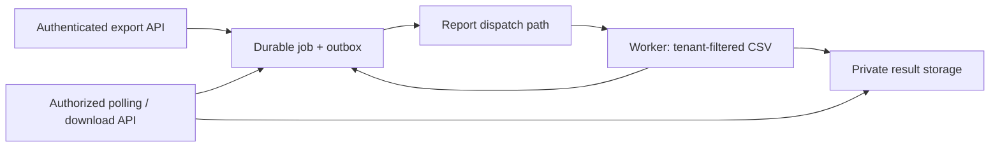

Reuse the report-job path initially. A second queue would not provide retry safety; add one only if measurements show exports need separate scheduling or worker capacity.

The fixture already has tenant-scoped deduplication in `enqueue_once` and ownership checks in `get_for_tenant`. All three existing tests pass. Its in-memory store is not durable or concurrency-safe; `complete` has no retry protection, `render_report` does not escape CSV, and `RESULT_TTL_HOURS = 24` is unused. The HTTP layer, production persistence, and queue implementation are absent.

1. **Define submission identity and persist it atomically.** Assume a logical request is `(authenticated tenant, idempotency key)`. Bind the key to a hash of normalized export parameters; a repeated key returns the original job, while changed parameters return a conflict. Require a new key for a deliberately fresh export. Store parameters, status, timestamps, attempts, and result metadata durably, with a unique constraint on the tenant/key pair. Keep the identity record after file expiry so delayed retries cannot silently create another job. Confirm this identity/retention contract before implementation.

2. **Make enqueueing and execution recoverable.** Create the job and an outbox entry in one transaction, then dispatch through the report-worker path described in the README. Confirm its production integration before selecting queue-specific mechanics. Use leases and fenced attempts, bounded retries with backoff, and a terminal failed state. A redelivery returns or resumes the existing job; stale workers cannot overwrite newer attempts. Publish the private result before atomically marking complete, clean orphaned uploads, and make completion idempotent so retries never extend expiry.

3. **Add the API and CSV result.** Submission returns the job ID and status URL; polling reports queued, running, complete, or failed, with expiry information. Enforce authenticated tenant ownership on submission, polling, and every download, and apply tenant filters inside worker data queries. Use Python's CSV writer for escaping and stream large exports. Keep result objects private; downloads use an authorized proxy or short-lived signed URLs whose expiration never exceeds the result deadline.

4. **Enforce seven days from successful completion.** Persist `completed_at` and `expires_at = completed_at + 7 days`; replace the unused 24-hour setting with enforced policy. Deny access at the deadline even if deletion is delayed, delete expired files with scheduled cleanup, and retain an expired job record for polling and deduplication. Cross-tenant lookups should reveal no job details.

5. **Measure, test, then roll out.** At 5,000/day, average arrival is only about 0.058 exports/second; this says little about bursts or job duration. Benchmark representative sizes and peak concurrency, measuring queue wait, render time, memory, database impact, failures, and interference with existing reports. Size workers from peak arrival rate and measured duration, with headroom. Introduce a separate export queue/pool if isolation or priority needs justify it; splitting queues alone adds no capacity. Roll out behind a tenant flag with concurrency limits and alerts for queue age and failures.

Acceptance checks: simultaneous duplicate submissions create one job; key/payload conflicts fail; tenant isolation covers jobs, rows, and files; crashes around dispatch, upload, and completion recover safely; stale attempts cannot publish; CSV quotes, commas, newlines, Unicode, and large inputs work; downloads stop precisely seven days after completion despite cleanup lag. Production throughput remains an open measurement, not a proven capacity claim.
