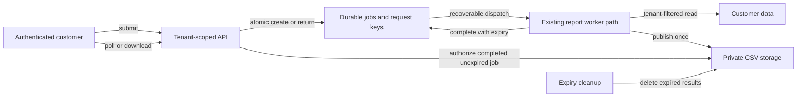

Reuse the report-job interface for CSV exports; defer a second queue until measurements show that shared scheduling cannot meet export and report latency targets. The current tenant-scoped request-key lookup already supplies the intended sequential deduplication shape. A separate queue would add operations without fixing durable idempotency, result retention, or authorization.

This is a standard-effort, planning-only proposal. Success means one durable job per tenant and logical request, tenant-authorized polling, valid CSV, and a completed result downloadable for seven days. Production HTTP, persistence, storage, and scheduling are not supplied; their integration points must be inspected before implementation. Replacing the service architecture is outside scope.

Material evidence:

| Status | Finding and consequence |
|---|---|
| Observed; tested narrowly | [JobStore.enqueue_once](../../eval-fixtures/engineering/service.py#L21) and [existing tests](../../eval-fixtures/engineering/test_service.py#L7) return one job for sequential repeats and distinguish tenants. These tests do not establish concurrency or restart safety. |
| Observed | [JobStore](../../eval-fixtures/engineering/service.py#L16) uses process-local dictionaries, with no atomic persistence or dispatch mechanism. [complete](../../eval-fixtures/engineering/service.py#L34) takes only a job ID. Production guarantees are unknown, not proven absent. |
| Observed; tested | [render_report](../../eval-fixtures/engineering/service.py#L40) concatenates commas. A local CSV-reader round-trip probe failed on commas and embedded newlines. |
| Observed | [The TTL constant](../../eval-fixtures/engineering/service.py#L4) is 24 hours and unused; jobs have no completion/expiry timestamps. No download or expiration enforcement is present. [README](../../eval-fixtures/engineering/README.md#L3) explicitly excludes HTTP and production persistence. |

Two decisions need owner confirmation before their dependent work:

- **D1 — Request identity.** Recommend a client-supplied operation key, scoped to the authenticated tenant, with a stored canonical-parameter fingerprint. Same key and parameters returns the same job; changed parameters conflicts. A deliberate refresh uses a new key. Retain the key/job tombstone after result expiry, so retries cannot silently create another export. Confirm this versus automatic deduplication of identical parameters, and approve a finite deduplication window if indefinite metadata retention is unacceptable.
- **D2 — Capacity acceptance.** Agree maximum export size, peak arrival profile, acceptable export wait/completion time, and existing-report latency guardrail. The stated 5,000/day averages about 0.058 requests/second; it does not establish worker capacity.

Proposed flow; the report-worker relationship is described by README, while the durable dispatch, HTTP, and blob boundaries below are proposed:

Deliver in this dependency order; all acceptance checks below are future work:

1. **Contract and integration inventory.** Resolve D1; inspect the real HTTP authentication, durable store, dispatch/recovery, data-query, and storage contracts. Specify CSV columns, ordering, encoding, and whether data reflects submission or execution time. Proposed endpoints are submit, status, and download; retain `enqueue_once` and `get_for_tenant` semantics. Acceptance: documented request identity and statuses (`queued`, `running`, `complete`, `failed`, `expired`), conflict behavior, and indistinguishable not-found responses for missing or foreign jobs.
2. **Durable job lifecycle.** Extend the production equivalent of `Job`/`JobStore` with fingerprint, timestamps, attempt/lease ownership, and result reference. Enforce atomic uniqueness on `(tenant, request_key)`. Couple creation to recoverable dispatch using the existing reliable mechanism; add an outbox or pending-job recovery only if necessary. Worker retries and duplicate deliveries keep one job; bounded attempts end in `failed`. Fence stale workers so they cannot overwrite a published result or reset expiry. Acceptance: concurrent submissions, restart, lost dispatch, duplicate delivery, worker crash, and stale completion all preserve one observable job and recover or fail visibly.
3. **CSV and seven-day delivery.** After lifecycle design, replace `render_report` concatenation with the standard CSV writer, preserving existing simple output where practical; stream large exports. Scope source queries to the stored, authenticated tenant. Publish the private result before atomically completing its job; set expiry to completion plus 168 hours. Check tenant ownership and expiry on every poll/download, and prevent bypass through public blobs or reusable links. Downloads started after expiry fail even if deletion is delayed; cleanup removes blobs and abandoned partial results without removing deduplication tombstones. Acceptance: CSV round trips for commas, quotes, newlines, and Unicode; spreadsheet-formula handling follows an explicit output policy; cross-tenant submit/poll/download/worker attempts fail; controlled-clock tests cover just before, at, and after expiry, repeated completion, and cleanup failure.
4. **Capacity and rollout.** After D2 and a representative implementation, measure throughput, memory, retries, queue age, and report latency across realistic sizes and bursts. Apply bounded concurrency and per-tenant limits. Start with limited tenants, then expand only when agreed targets pass with headroom. Rollback disables new export submissions while preserving polling, recovery, and downloads for accepted jobs through their promised expiry.

A dedicated export queue and worker pool becomes preferable if measured export work delays ordinary reports or requires materially different scheduling/resources. It provides isolation but still needs the same durable keys, tenant checks, and retention work. A second queue alone offers neither correctness nor additional processing capacity; observed contention or an inability to enforce fairness would reverse the initial recommendation.

Verification receipt: Python 3.9.6 ran all three existing tests successfully; one read-only probe exposed malformed CSV and confirmed the fixture's 24-hour constant and missing timestamps. No capacity, production concurrency, authorization, or seven-day behavior was tested. The diagram was checked against the proposed flow but not rendered. One fresh same-model critic found no material issues; no follow-up was needed. Stopped after settled review; D1/D2 remain owner decisions. Source fixtures are unchanged.
