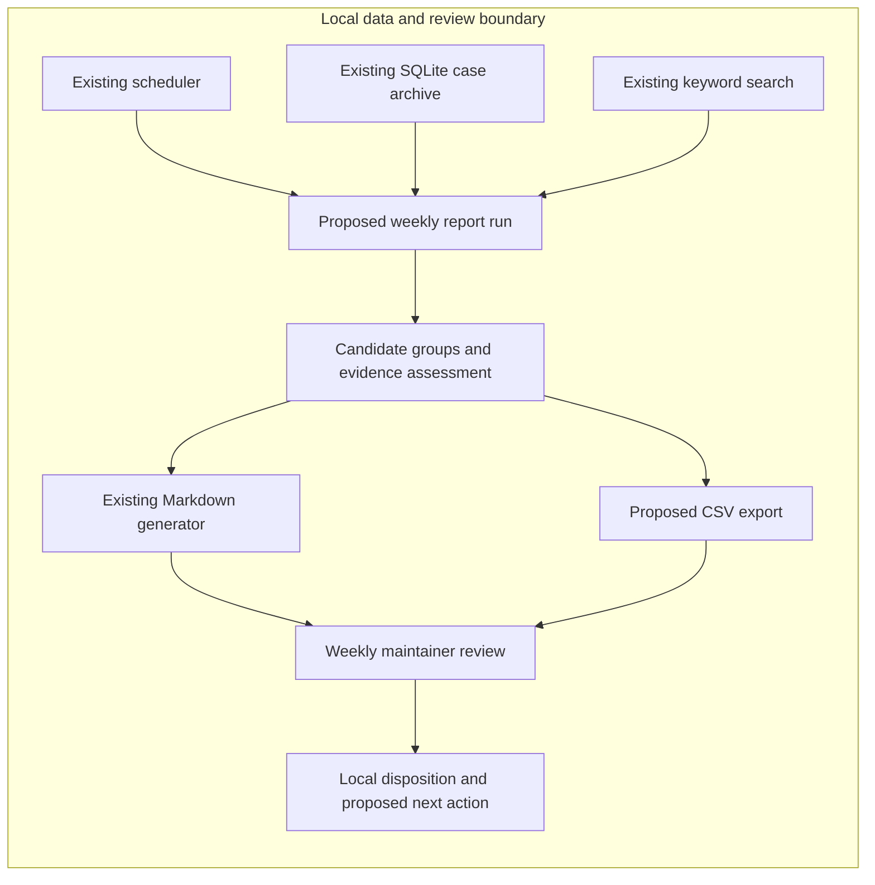

# A weekly report of recurring support issues

Start with a local weekly report that helps the maintainer decide whether a recurring issue merits investigation or a fix. Reuse the SQLite archive, keyword search and Markdown generator, and add CSV export as part of the proposed delivery. The first proof is whether the report supports useful, evidence-backed maintainer decisions; producing a report alone does not establish that.

The later user update settles the cadence and scope: weekly reporting, no dashboard, and no continuous observation. The initially requested vector database and separate observer/critic agents are deferred because their value depends on a problem that has not yet been measured. Raw support text stays local. Every change remains a proposal requiring human approval; this plan authorizes no implementation, external posting or automated edits.

**Evidence and the deciding uncertainty.** [Supplied case 1](../../../eval-fixtures/planning-refinement.md#1-repeat-support-issues) reports an existing local archive with timestamps and stable case IDs, keyword search, a daily scheduler and a Markdown generator. These are **observed in the supplied description**, not inspected or tested here. The frequency with which similar cases share a root cause and the accuracy of any grouping are **unknown**. It is **inferred** that reusing those components is the smallest credible way to test usefulness; it is not established that keyword similarity is a reliable grouping method.

**Proposed architecture.** All processing and review artifacts remain local. Existing components are marked below; the weekly orchestration, evidence assessment and CSV output are proposed. The scheduler's current daily cadence is not evidence that a weekly job has been configured.

The weekly run selects an explicit reporting period and searches for recurring symptoms. Stable case IDs make the distinct-case counts auditable. Related older cases may supply context, but must be distinguished from that week's count. The evidence assessment checks whether each group supports only a shared symptom or also a plausible common cause, and includes conflicting case resolutions when available. It can be a simple report preparation step; it does not require another agent or service.

Both exports come from the same assessed candidates. Each proposal explains the recurring problem, points to the supporting cases, separates known evidence from the root-cause hypothesis, and suggests a bounded next action. If the cause is unsupported, the next action is an investigation rather than a purported fix. CSV must preserve the evidence references and uncertainty needed for review; the illustrative `R-001` row is not a required schema. Keep raw case text out of the CSV and use local case references; any excerpts in the Markdown report also remain local.

The maintainer records whether the group is coherent, whether the evidence supports the proposed action, and whether to reject, investigate or approve it. Approval records a decision; it does not trigger execution or posting. This feedback supplies the evidence for any later decision about automation.

| Approach | Why use it or defer it | Evidence that would change the choice |
|---|---|---|
| Reused search plus a weekly evidence report — recommended | Tests recurring-issue discovery while retaining local provenance and a bounded weekly review. Group quality is still unproven. | If candidate preparation or false grouping consumes more effort than manual review, simplify to manual curation. |
| Maintainer-curated weekly report using the existing archive and search | A credible smaller alternative and a comparison for the first proof. It may be sufficient at the actual case volume. | Prefer it if automated candidate selection finds no additional useful issue or saves no observable effort. |
| Vector retrieval and separate observer/critic agents | Deferred. No evidence yet shows that semantic retrieval or extra agents solve the limiting problem. Continuous observation and a dashboard are outside the current decision. | Reconsider retrieval only if useful reports repeatedly miss confirmed recurring issues because wording differs. Revisit additional automation only after demonstrated report usefulness and a concrete remaining workload. |

**First useful delivery and proof.** Use one recent complete weekly period as a retrospective rehearsal. As a reversible working assumption, cap the first report at five candidate groups so one maintainer can review it; an empty or inconclusive report is a valid result. The cap limits work, not the number of underlying cases that may support a group.

1. **Establish the review sample.** First identify the period, eligible distinct cases and available resolution evidence. Inspect a small sample to establish what the archive can actually support. Acceptance: counts and exclusions can be traced to case IDs; missing or ambiguous outcomes are explicit. If the archive cannot support causal assessment, the report must make symptom-level claims only.
2. **Prepare the paired local reports.** Using that sample and the proposed architecture, prepare Markdown and CSV versions of the same candidates. Acceptance: every count and material claim has a traceable basis; neither output conflates similar wording with a verified common cause; CSV and Markdown agree on candidates, counts and recommended actions. No external system is changed.
3. **Have the maintainer challenge the report.** Before seeing its candidate list, the maintainer performs a bounded manual scan of the same period using the existing search, recording time and any recurring issues found. Then review the report, inspect supporting and contradictory cases, and sample cases left out of its groups. Acceptance: record false merges, missed candidate issues, useful new findings and the total preparation/review effort separately. This is a small initial comparison, not a population accuracy benchmark or independent causal adjudication.

Continue weekly reporting only if the maintainer can use the evidence to make a concrete decision about at least one recurring issue and considers the review effort worthwhile compared with the manual scan. Count an investigation decision as useful only when the report supplies a specific, supported question to resolve. If all groups are merely similar wording, or manual review is equally useful with less effort, retain manual curation or revise candidate selection before repeating. One useful report justifies another bounded report; it does not justify continuous operation. Repeated usefulness and a demonstrated remaining bottleneck are prerequisites for reconsidering automation.

There is no outstanding user decision that blocks this plan. The five-group cap is an adjustable assumption; the first sample must establish actual case volume and evidence quality. Outcomes are **pending — no report, benchmark or maintainer assessment has run**.

Self-checked against the supplied goal, later update, local-data boundary, human approval boundary, CSV requirement and evidence limitations. Diagram edges were checked against the prose; rendering was not checked. **Self-checked; independent review unavailable** because additional agents are prohibited. Stop reason: review-unavailable; the next useful evidence requires the proposed report rehearsal, which is outside this artifact-only exercise.
