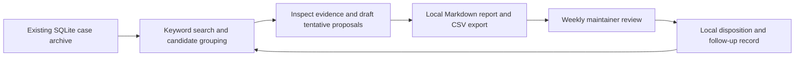

# Repeat support issues: weekly evidence report

Recommend a manually initiated weekly report using the existing local archive, keyword search and Markdown generator, with a companion CSV export. Its first purpose is to establish whether apparently recurring cases support useful maintainer decisions. Similar wording is not yet evidence of a shared root cause; a continuously running multi-agent service would commit to a mechanism before that uncertainty is resolved.

Artifact ID: C1. Status: proposed plan, 2026-10-31. Outcomes: pending. This file is the canonical exercise artifact; no live planning-library record was created.

## Current brief and evidence

The later update supersedes continuous observation: start weekly, retain CSV, exclude the rejected dashboard, and revisit automation only after usefulness is demonstrated. Raw support text must stay local. Humans approve any proposed change; this workflow performs no code edits or external posting.

The supplied case describes an existing SQLite archive with stable IDs and timestamps, keyword search, daily scheduler and Markdown generator. These are supplied facts, not capabilities independently tested here. No accuracy benchmark or reliable estimate of shared root causes exists. The one available maintainer can review weekly; their practical review capacity is unknown.

## Architecture and responsibilities

The proposed flow is local and initiated by a person each week:

- **Archive and search:** retain original text locally and use stable case IDs to trace each proposal to evidence. Identify the reporting window and distinguish new cases from previously reported cases.
- **Candidate preparation:** a report preparer uses keyword search, reads the matched cases and separates symptoms from proposed causes. Count distinct cases supporting each claim; label suspected causes and conflicting cases explicitly. A plausible issue can justify further investigation without justifying a fix.
- **Report and export:** reuse the Markdown generator and add the required CSV companion. Both represent the same proposals, evidence references, uncertainty and suggested next action. Keep raw support text out of the exported summary; evidence remains accessible through local case references. The illustrative `R-001` format imposes no naming or schema requirement.
- **Maintainer review:** accept a proposed next action, request evidence, defer or reject. Record the rationale locally so later reports can recognize duplicates and assess usefulness. Approval is a decision record; execution of any change belongs to a separately authorized workflow.

A preparer must own the weekly compilation; the maintainer owns assessment and approval. One person may perform both roles if the work fits their capacity. The existing daily scheduler is unused in the first proof, consistent with deferring automation.

## First useful delivery and credible proof

1. **Produce one inspectable report and matching CSV.** Use a bounded recent archive window, record its dates and case count, and produce a short candidate list sized for one weekly review. Each candidate must expose its supporting case IDs, recurrence count, proposed action and uncertainty. Completion means the maintainer can trace the claim without searching for its source, and the CSV preserves the report's substantive content.
2. **Test whether the evidence supports the proposed action.** During that review, inspect all cases supporting the short list, including contradictory examples. Check a small sample outside the keyword matches to look for obvious misses. Record incorrect groupings, unsupported cause claims, duplicates and review effort. This is a bounded relevance check, not a validated accuracy benchmark or population recall estimate.
3. **Make a continuation decision from the review.** Record whether any proposal led to a concrete, evidence-supported next action and whether preparation plus review fit the available weekly capacity. Rejection or a finding that the evidence is insufficient is a valid result. If useful, repeat the weekly report to test consistency before considering automation; if not, revise the grouping approach or stop.

The expected benefit is fewer unsupported investigations and less effort identifying recurring issues. It remains a hypothesis until review results exist. A completed report alone does not demonstrate that benefit.

## Alternatives and revisit conditions

A wholly manual review of recent archive cases is the credible fallback and a useful control for a small sample: it needs little setup but may consume more review time. Keyword-assisted preparation is preferred because search and report generation already exist, while preserving direct inspection of the evidence. Choose manual review if search misses too much or candidate cleanup costs more than reading the cases.

A vector database, observer, critic, persistent proposal queue and dashboard are excluded from this first delivery. A report plus local dispositions serves the current weekly assessment need. Revisit retrieval technology only if documented misses show that keyword search is the limiting factor; revisit scheduling or agent roles only after repeated useful reports reveal a specific task worth automating. The dashboard remains rejected unless the user changes that decision.

Next action: assign the report preparer and select the first archive window. These are reversible operational choices, not reasons to delay the architecture. No clarification is necessary to use this plan.

Checks: one self-check against the supplied request and update; no archive inspection, benchmark or independent review. The Mermaid flow was checked against the prose but not rendered. Detailed execution receipt: [receipt](receipt.md). Stop reason: review-unavailable; the proposed first proof supplies the next missing evidence.
