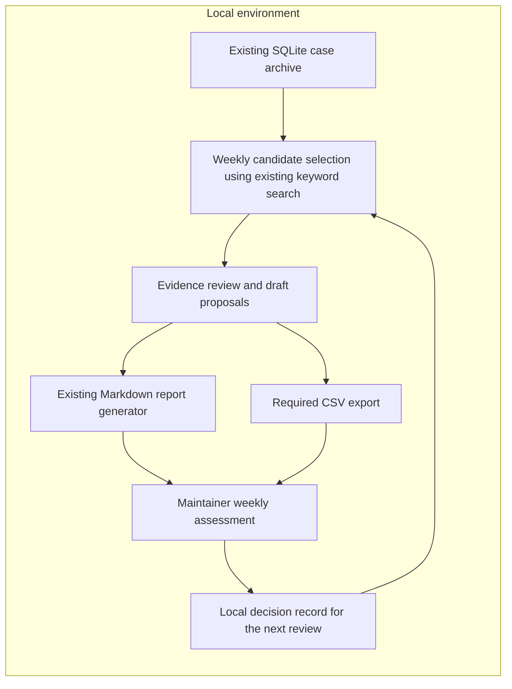

Start with a local weekly report that helps one maintainer decide which recurring support problems deserve investigation or a proposed fix. Reuse the archive, keyword search and Markdown generator; add the required CSV export. The first proof is whether a maintainer can assess the evidence and reach a useful decision, not whether a continuously running service can produce proposals.

This is the canonical artifact for case 1, dated 2026-10-31. Status: planned; outcomes pending. Evidence is the supplied description and later update in [cases.md](../../../eval-fixtures/planning-refinement.md), request 1; no archive inspection or accuracy benchmark has been performed.

The later update settles the initial scope: weekly reports, CSV retained, dashboard rejected for now, and automation reconsidered only after reports prove useful. The original vector database and multiple-agent arrangement are proposed mechanisms without evidence that they are needed. Keep human approval mandatory, raw support text local, and automatic code edits and external posting outside the architecture.

The proposed flow is:

The archive owns case IDs, timestamps and source evidence. Candidate selection finds potentially related cases; it does not establish a shared root cause. Evidence review checks distinct cases, contrary examples and alternative explanations, then produces a concise issue summary, linked local evidence, confidence limits and a proposed next action. Markdown and CSV present the same reviewed content. The maintainer owns acceptance, rejection or requests for more evidence. A saved decision prevents repeatedly presenting the same unresolved or rejected proposal without new information. These are responsibilities, not separate services or agents. The diagram describes a proposed workflow and has been checked against the prose but not rendered.

Use a manual weekly run initially. The existing daily scheduler is available for later reuse; the latest instruction does not call for activating it now. Reports and decisions remain local in this first delivery. Keep raw support text in the archive; use case IDs and carefully written summaries in reports rather than copying raw messages. There is no execution or posting component after the maintainer's decision. Approval here records a decision; any implementation or external communication requires separate authorization.

Two approaches are credible at this stage:

| Approach | Benefit and limitation | Decision |
|---|---|---|
| Weekly evidence report using existing tools | Small delivery with a direct test of assessability; keyword matches can miss differently worded cases and can group unrelated causes. | Start here. Explicitly examine misses and false groupings. |
| Add local semantic retrieval and automated proposal generation | Could find differently worded cases or reduce repetitive preparation, but accuracy, extra maintenance and review burden are unknown. | Defer. Reconsider if useful reports repeatedly miss relevant cases or preparation effort becomes the limiting factor. Compare against the existing workflow before adoption. |

A vector database, continuous observer, separate critic service, dashboard and durable proposal-queue service do not yet remove a demonstrated obstacle. The weekly report and local decision record provide the necessary review queue. Removing CSV would violate an explicit requirement; removing the architecture or evidence check would leave the requested first proof incomplete. The example report identifier and wording are illustrative, not a required schema.

The first useful delivery has two dependent results:

1. **A reviewable weekly report in Markdown and CSV.** Assemble a small candidate set from a stated archive time window, fitting one maintainer's weekly attention. Check the source case IDs and distinguish repeated symptoms from an evidenced shared cause. Any claim of recurrence needs more than one distinct case; report symptom counts separately from confirmed or hypothesized common-cause counts. Each proposal must make clear what is known, what remains hypothetical and what decision is requested. Done when both formats contain the same proposals, evidence references and uncertainty; every factual claim is traceable locally; and no code edit or external posting occurs. An honest report with no supported candidates is valid delivery but does not prove usefulness.
2. **A recorded first usefulness assessment.** The maintainer assesses the report and a bounded sample of source cases. Include cases outside the keyword-selected groups as a check for obvious missed themes, and inspect within-group cases for distinct causes. Record the sample's selection limits, false groupings, missed themes, decisions and preparation/review effort. Done when the record distinguishes proposals that were assessable, those needing more evidence and those rejected, with reasons. At least one evidence-backed issue that supports a useful investigation or fix decision is a positive first signal; a polished report alone is not. No result from this small, selected sample establishes general accuracy.

The first step is to prepare that local sample and report, then obtain the maintainer's assessment. The archive and tools are available according to the supplied facts; root-cause recurrence, proposal quality and reviewer burden remain unknown. No clarification is needed to begin this bounded proof. If weekly assessments fail to yield useful decisions, stop or revise the evidence-selection method before adding automation. If they succeed, repeat enough to establish whether the benefit persists and identify the actual bottleneck before proposing any additional service.
