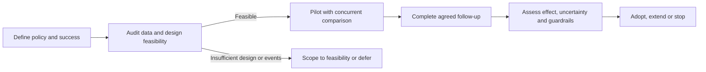

# Review: four-day workweek and retention

**Verdict: revise.** The supplied evidence supports investigating a four-day week, but cannot establish a retention benefit or justify company-wide adoption. Use a defined policy, a concurrent comparison where feasible, and enough follow-up to observe the agreed retention outcome. Treat a four-week pilot as a feasibility check.

This is **standard review** as requested, with a self-check substituted for the prohibited fresh critic: **self-checked; independent review unavailable**. The original plan is preserved in [input.md](../../eval-fixtures/research.md).

## Material findings and corrections

1. **A and B are one evidence origin.** Observed in the packet: B repeats A and links only to A. A is vendor-authored, has one 80-person setting, and lacks a comparator, raw counts, and reporting-period definition. Its reported 20% reduction is neither independent corroboration nor an established causal effect. Correct step 1 to describe a hypothesis-generating case report; do not import its effect size as the company's expected result.
2. **C does not identify a policy effect.** Observed: compensation bands and managers changed, and no policy experiment occurred. Whether any shorter-week policy was introduced is unknown. Tested arithmetic using the stated headcounts gives crude resignation proportions of 6.00% and 3.64%, a 2.36 percentage-point decrease (39.39% relative); the raw count decrease is 33.33%. These are descriptive calculations, not annual retention estimates or causal effects. Correct step 2 to state an unexplained before/after difference; verify exposure, employee movement, and resignation definitions before treating these proportions as comparable rates.
3. **The success criterion cannot support the proposed decision.** Step 3 combines four weeks of observation with annual retention, and leaves “improves 20%” undefined. Lower turnover and higher retention are different quantities; relative and percentage-point changes also differ. Four weeks cannot directly observe annual retention. Define one primary outcome, its denominator, a meaningful effect, and follow-up before launch. If annual retention remains primary, observe a full year; any shorter-window result must be labeled accordingly. With only ten reported exits across the supplied periods, an adequately informative effect estimate is not assured.
4. **The intervention and competing explanation are unresolved.** D reports a preference for flexibility over fewer days among several interviewees; missing sampling details prevent a company-wide prevalence claim. A compressed schedule, fewer paid working hours, and schedule flexibility are distinct interventions. Define the intended policy and include flexibility as a serious alternative; do not assume fewer days is the mechanism employees value.
5. **Adoption is premature and the diagram contradicts the text.** Step 4 places adoption after the trial, while the existing diagram places adoption before it. Neither sequence includes an adequate evidence gate. Put any adoption decision after sufficient follow-up and assessment of uncertainty, feasibility, and guardrails.

## Concise research approach

**Goal:** estimate whether the specified policy reduces voluntary departures in this company while preserving agreed operational outcomes. Success means a decision supported by a defined outcome, credible comparison, and reported uncertainty—not necessarily a positive result. Literature expansion and implementation are outside this review.

| Deliverable | Dependencies and acceptance |
|---|---|
| Auditable baseline and protocol | First verify employee eligibility, exits, exposure, hiring, and compensation/manager changes. Specify policy, primary outcome, effect threshold, guardrails, and analysis before enrollment. Acceptance: consistent denominators and a feasibility/precision assessment using available teams, follow-up, and likely exit counts. |
| Bounded pilot with comparison | Depends on the protocol. Prefer randomized assignment of eligible teams to policy or current schedule if sufficient teams and operational separation make that credible. Track implementation and concurrent changes. Four-week acceptance covers feasibility and guardrails only; retention follow-up continues for the predeclared window. |
| Decision report | Depends on completed follow-up. Compare outcomes over the same window, report effect estimates and uncertainty, deviations, and operational results. Acceptance: distinguish benefit, harm, and inconclusive evidence against predeclared criteria; inconclusive results do not trigger adoption. |

If randomization is infeasible, a concurrent comparison with pre-period data is a smaller alternative, but selection and concurrent changes limit causal attribution. A flexibility pilot is a competing policy option motivated by D; representative employee input can refine it but cannot demonstrate retention effects. If event counts cannot support a useful comparison, limit the research claim to feasibility and preferences, or extend the study. That feasibility finding would reverse the recommendation for an efficacy trial.

This is the **proposed** sequence; syntax and prose alignment were checked manually, without rendering.

## Decisions required before execution

- **D1 — Policy:** reduced hours, compressed hours, or flexibility. Recommend clarifying this using broader employee input; D cannot select the policy alone.
- **D2 — Evidence standard:** causal trial or exploratory pilot. Recommend a concurrent randomized design if the feasibility assessment supports it; otherwise explicitly accept weaker inference.
- **D3 — Outcome and commitment:** specify meaningful turnover reduction, follow-up, operational guardrails, and acceptable uncertainty. Recommend a directly observed outcome over its actual measurement window; thresholds require company judgment.

## Verification receipt

Read only the supplied packet and the skill's two instruction files. Source A–D originals were not supplied; source descriptions are packet observations, not independent verification. Review conclusions are inferred from that packet; research tasks are proposed. Recomputed C's arithmetic and checked evidence origins, causal support, outcome/window alignment, alternative coverage, dependencies, and diagram agreement. No study, power analysis, renderer, web research, or independent review was run. Review calls: **0**; additional review contexts: **0**. Stopped at the evidence and delegation limits. Details: [receipt.json](receipt.json).
