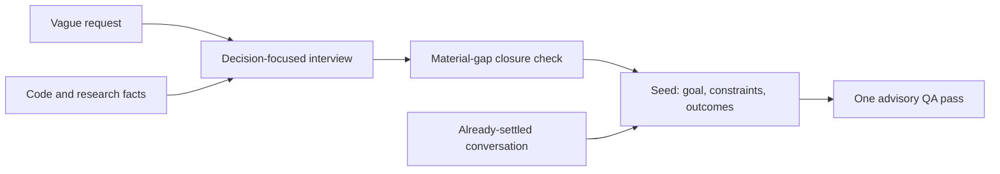

# What to borrow from Ouroboros planning

**29 October 2026 · Source review; proposed adaptations, not adopted.** Inspected [Q00/ouroboros at `cc0d89e`](https://github.com/Q00/ouroboros/tree/cc0d89e5a994aa7e38d7f3151aa25698a6c31f8d), including prompts, Python implementation and selected tests. The repository is [MIT-licensed][license]. This snapshot does not establish which version or process produced the supplied handoff.

**31 October follow-up:** the user authorized the adaptations and a shorter skill. Version 0.9.0 implements them; [comparison and limits](refinement-evaluation.md). The source observations below retain their original date; improved readability remains unestablished.

The useful pattern is **question the proposed solution, select justified requirements, then preserve the decisions that survive**. Its mechanisms are concrete enough to trial. Their presence does not demonstrate better plans or readability.

## How it works

The host inspects sources; the interview engine generates questions and tracks ambiguity. Facts describe what exists; user decisions define what should change. Contrarian and simplifier roles challenge the framing, while a breadth keeper preserves other requested outputs. Closure checks whether unresolved choices would change execution. A settled conversation can bypass another interview. The Seed is an execution contract, not a human-readable plan template. [Interview][interview], [questioning][socratic], [closure][closer], [settled context][session].

## Adapt within our existing skill

| Mechanism | Useful adaptation |
|---|---|
| **Challenge the premise** | Before expanding a consequential suggestion, distinguish the desired result from the proposed mechanism. Ask whether the mechanism addresses the actual problem and what would happen without it. Investigate or ask only where the answer could change the recommendation. [Contrarian][contrarian] |
| **Cut with a preservation check** | Ask what breaks if a component is removed. Preserve explicit requirements, dependencies and consequential constraints; recommend scope changes openly. Check other requested outputs after narrowing one thread. [Simplifier][simplifier], [breadth keeper][breadth] |
| **Distill outcomes** | Read each acceptance condition beside its siblings. If it merely describes a means toward another outcome, merge it into that outcome. Retain a user-required method as a constraint and a necessary architectural choice in the design. Examples do not become exact-output requirements without a reason. [Seed architect][architect] |
| **Keep decisions distinct from evidence** | Preserve accepted decisions, rationale, exclusions and corrections through synthesis. Research findings and agent suggestions may inform the choice without becoming commitments. Our existing records should carry this distinction; a new schema or confirmation on every answer is unnecessary. [Provenance][provenance], [revision audit][seed] |
| **Close on material uncertainty** | Continue only when an unresolved question could change the direction, architecture, scope or acceptance for the plan's maturity. Stop wording-only refinement; skip intake that the conversation already settled. [Closure][closer], [settled context][session] |

Our skill already covers minimal alternatives, material questions, decision records, architecture and bounded review. The candidate should sharpen those instructions, especially **premise challenge and outcome distillation**, rather than add roles or another checklist. These are planner questions, not mandatory final headings. The existing critic can check unjustified additions and lost obligations together.

## Leave behind

- **The simplifier's 50% removal quota.** It can reward losing necessary scope. Borrow the necessity question, not a predetermined reduction. [Source][simplifier]
- **Routine multi-agent fan-out and repeated approval gates.** The interview describes per-question advisory lanes, milestone reviews, structured-answer confirmations and a three-role closure guard. That adds interaction and model work; actual cost was not measured. Use our conditional scouts and bounded review. [Source][interview]
- **The full execution schema.** Exact verification commands and ontology fields serve Ouroboros's runner. Early research and architecture plans can preserve semantic boundaries without prescribing code details. [Source][architect]
- **Scores as proof.** The inspected turn planner requests model-generated clarity values; code aggregates them and checks floors. This is readiness signaling, not independently measured correctness. Seed QA is explicitly advisory, including a low verdict. [Turn planner][turn], [aggregation][ambiguity], [QA][seed]

## What source checks establish

| Check | Finding and limit |
|---|---|
| **Provenance probe, executed** | Loaded the inspected, standard-library-only provenance module with Python 3.13.7. Four classifications and a three-round projection behaved as specified: marked observations and declared assumptions are withheld from requirement answers; question context and user answers survive. Untagged facts and `from-auto` answers classify as `user`. This is a boundary mechanism dependent on caller labeling, not reliable human-intent recognition. No full runtime or model execution ran. [Module][provenance] |
| **Distillation, source inspected** | Strict filtering applies to reference-aware interviews; non-reference extraction is preserved. Explicit-requirement detection uses patterns. The verbatim backstop only appends, so a paraphrase can coexist with the original. Do not claim general semantic deduplication or lossless interpretation. [Implementation][distillation] |
| **Tests, inspected but not run** | Requirement-distillation tests cover the non-reference path and append/no-op anchoring; session tests check supplied-string preservation. Granularity tests assert prompt content, not improved generated outcomes. [Distillation tests][distillation-tests], [session tests][session-tests], [prompt tests][prompt-tests] |

One bounded scout inspected seed/distillation sources; the planner reopened decisive files and checked contrary evidence. A separate fresh critic checked this fixed recommendation against the sources and current skill, found no material correction, and judged it ready for a narrow trial. Both agents inherited the available model settings; this was not a different-model comparison. One scout call and one review call; no follow-ups. Stop reason: settled on what to trial; efficacy unresolved.

No dependencies were installed, full upstream suite run, or end-to-end comparison performed. Source coverage is the planning path above, not an audit of Ouroboros's whole runtime.

## Adoption evidence still needed

Trial a narrow candidate against the current skill on the same inputs: an overbuilt idea, explicitly broad request, clear small task and early exploration. Include a required method, illustrative example, rejected proposal and later correction across those cases.

Assess unsupported commitments, lost decisions, duplicated outcomes, a useful next step, and reader effort; record interaction/tool work separately. Blind ordering can reduce presentation bias. The user judges whether the outputs are easier to use. Shorter output, model agreement and passing prompt-text assertions are insufficient. See the [current proposal](idea-shaping.md).

[license]: https://github.com/Q00/ouroboros/blob/cc0d89e5a994aa7e38d7f3151aa25698a6c31f8d/LICENSE
[interview]: https://github.com/Q00/ouroboros/blob/cc0d89e5a994aa7e38d7f3151aa25698a6c31f8d/skills/interview/SKILL.md#L72-L170
[socratic]: https://github.com/Q00/ouroboros/blob/cc0d89e5a994aa7e38d7f3151aa25698a6c31f8d/src/ouroboros/agents/socratic-interviewer.md#L23-L65
[contrarian]: https://github.com/Q00/ouroboros/blob/cc0d89e5a994aa7e38d7f3151aa25698a6c31f8d/src/ouroboros/agents/contrarian.md
[simplifier]: https://github.com/Q00/ouroboros/blob/cc0d89e5a994aa7e38d7f3151aa25698a6c31f8d/src/ouroboros/agents/simplifier.md
[breadth]: https://github.com/Q00/ouroboros/blob/cc0d89e5a994aa7e38d7f3151aa25698a6c31f8d/src/ouroboros/agents/breadth-keeper.md
[closer]: https://github.com/Q00/ouroboros/blob/cc0d89e5a994aa7e38d7f3151aa25698a6c31f8d/src/ouroboros/agents/seed-closer.md
[architect]: https://github.com/Q00/ouroboros/blob/cc0d89e5a994aa7e38d7f3151aa25698a6c31f8d/src/ouroboros/agents/seed-architect.md#L62-L125
[session]: https://github.com/Q00/ouroboros/blob/cc0d89e5a994aa7e38d7f3151aa25698a6c31f8d/src/ouroboros/bigbang/session_seed.py#L62-L107
[provenance]: https://github.com/Q00/ouroboros/blob/cc0d89e5a994aa7e38d7f3151aa25698a6c31f8d/src/ouroboros/bigbang/answer_provenance.py
[distillation]: https://github.com/Q00/ouroboros/blob/cc0d89e5a994aa7e38d7f3151aa25698a6c31f8d/src/ouroboros/bigbang/requirement_distillation.py#L276-L412
[turn]: https://github.com/Q00/ouroboros/blob/cc0d89e5a994aa7e38d7f3151aa25698a6c31f8d/src/ouroboros/bigbang/turn_planner.py#L134-L159
[ambiguity]: https://github.com/Q00/ouroboros/blob/cc0d89e5a994aa7e38d7f3151aa25698a6c31f8d/src/ouroboros/bigbang/ambiguity.py#L836-L852
[seed]: https://github.com/Q00/ouroboros/blob/cc0d89e5a994aa7e38d7f3151aa25698a6c31f8d/skills/seed/SKILL.md#L111-L172
[distillation-tests]: https://github.com/Q00/ouroboros/blob/cc0d89e5a994aa7e38d7f3151aa25698a6c31f8d/tests/unit/bigbang/test_requirement_distillation.py
[session-tests]: https://github.com/Q00/ouroboros/blob/cc0d89e5a994aa7e38d7f3151aa25698a6c31f8d/tests/unit/bigbang/test_session_seed.py#L25-L45
[prompt-tests]: https://github.com/Q00/ouroboros/blob/cc0d89e5a994aa7e38d7f3151aa25698a6c31f8d/tests/unit/bigbang/test_seed_generator.py#L3107-L3189
