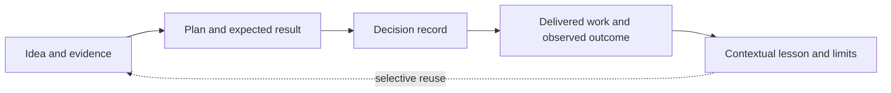

# Grounded Plan: research decisions and outcomes

Updated **21 October 2026**. This is repository documentation about the skill and its evaluation. Individual planning records live in a separate user-wide library. Start with the [research overview](overview.md), [pinned repository comparisons](repositories.md), and [pilot evidence](evaluation.md).

## What the research changed

The original requirement combined concise structured plans, useful diagrams, evidence checks, cross-checking and debate, and controlled overhead across engineering, product, and research. The survey covered 18 repository snapshots; selected source files were inspected, not every upstream runtime executed.

| Decision | Basis and limitation |
|---|---|
| Build a small standalone skill | `ce-plan` was the closest ready-made comparator; selected ECC, Ouroboros, Ralplan, and other mechanisms informed the design. Avoiding their full runtime dependencies fits the requested scope, but the custom candidate has not beaten them in a controlled benchmark. |
| Separate clarity, agreement, and evidence | A stable specification or agreeing reviewers cannot establish that its factual claims or future implementation are correct. Ouroboros's execution gate illustrates the value of separating executed checks from model review. |
| Scale review to the decision | Version 0.4.0 infers scrutiny from task context at the user's request, replacing named effort modes while preserving call caps. The original pilot found no material improvement from additional critics on its engineering plan, so more debate is not a demonstrated default benefit. |
| Preserve outcomes for later planning | The user requested storing decisions, delivered artifacts, observed results, and lessons. This supplies a place to compare expectations with evidence instead of losing the result after handoff. |
| Keep records user-wide | The user selected a separate user-wide folder. The implementation default is `~/.local/share/grounded-plan/`, configurable without changing the skill. Repository docs describe the method and public research evidence; personal records remain outside the checkout. |
| Keep planning grounded without implementing | Code inspection and permitted checks inform feasibility; product edits belong to a separate authorized phase. The user accepted this boundary and selective research delegation. |
| Delegate research selectively | Direct research remains the default. Scouts can compress bulky sources or investigate separable questions; the planner verifies decisive support. The two-call default is a provisional work budget, not a measured optimum. |
| Keep architecture without prescribing code | After reviewing current records, the user requested simpler plans while retaining architecture. Version 0.5.0 left code-level choices to the implementer; v0.6.0 replaced its word target and prescribed headings with adaptive output. Version 0.6.3 balances direct wording, explanation, and selective depth for the decision at hand. Readability and handoff improvements remain unmeasured. |

Detailed mechanisms, licenses, and immutable source references are in the [repository evidence](repositories.md). Those findings are tied to the 11 October snapshot; this update does not claim to repeat the upstream survey.

## Outcomes established so far

| Intended result | Observed result | Still unknown |
|---|---|---|
| A portable planning skill | Version 0.1.0 supplied a standalone instruction file, conditional review procedure, and scoped MIT license. | Comparative quality across real tasks and host differences. |
| Evidence-grounded planning | A synthetic engineering run found a real CSV defect with a probe; product and research runs exposed unsupported assumptions and evidence gaps. | Production engineering guarantees, real customer demand, and actual research effects. |
| Useful independent scrutiny | Standard review used one fresh critic; the deep component kept a critic and alternative author separate initially. Both stopped without a material dispute. | Quality gain from deeper review, cross-model effects, and behavior at the dispute cap. |
| Lower planning overhead | Instruction-level review budgets and selective source access limit workflow size. | Dollar savings or an optimal effort policy; no controlled cost benchmark was run. |
| A reusable outcome history | Version 0.2.0 adds a user-wide record/index contract and outcome capture. | Whether lessons improve later decisions over repeated real use. |
| Focused planning with selective research | Version 0.3.0 separates implementation from planning and adds optional bounded scouts. | Whether delegation improves quality, latency, or cost on real planning tasks. |
| A readable plan with architectural substance | Version 0.6.3 organizes around the reader's decision, explains the proposal, and matches depth and execution commitments to its purpose. Architecture and evidence limits remain visible. | Whether readers resolve decisions faster and implementers retain sufficient context. |

The original expectations above summarize the recorded research goal retrospectively; they are not newly claimed pre-registered evaluation hypotheses. The [0.1.0 pilot report](evaluation.md) retains its original scope and receipts.

The host's completed-goal meter reported **478,827 tokens and 1,761 seconds** for the initial research, construction, and pilot work together. That aggregate is not per-plan usage, a controlled comparison, or a bill; dollar cost was unavailable. It should not be presented as evidence that using the skill saves money.

## Planning boundary and research routing

Version 0.3.0 keeps code reading, source checks, and disposable probes available to the planner. It limits writes to planning artifacts and probes during planning; implementation is a separate authorized phase or handoff, even when one agent performs both phases. This is an instruction-level role boundary, not a filesystem permission system.

| Research shape | Default route |
|---|---|
| Small lookup, local check, tightly coupled reasoning | Planner directly, batching independent tool calls where useful |
| Bulky sources or separable questions | Optional scouts with distinct scopes and compact evidence packets |
| Claim that decides the recommendation | Planner opens underlying evidence and reconciles contradictions |
| Challenge to the completed plan | Fresh critic under the existing review policy, not the scout reviewing its own work |

The scout budget defaults to two calls total, including follow-ups, independently of review depth. User budgets take precedence. No recursive delegation is allowed. Packets contain provenance, source/version pointers, actual checks, counterevidence, and gaps; detailed evidence can stay behind links. Model settings inherit the host unless an appropriate available alternative is authorized. The receipt counts research and review separately.

The rationale is conditional: separate research contexts can compress large source collections and explore independent directions, but coordination and additional tokens carry costs. Anthropic's engineering report describes both effects and emphasizes bounded assignments; it does not validate this skill's thresholds. [Multi-agent research system](https://www.anthropic.com/engineering/multi-agent-research-system).

The revised scaling study likewise reports task-dependent benefits and coordination costs across 260 configurations and six benchmarks. Applying those results to this planner is a design inference, not direct evidence of savings. The adopted policy favors direct investigation until delegation has a concrete purpose. [Scaling Agent Systems, v3](https://arxiv.org/abs/2512.08296v3).

The complete conditional procedure lives in [scouts.md](../../skills/grounded-plan/scouts.md). No new flag, runtime, mandatory model tier, or always-on agent team is introduced.

## Storage and use

```text
~/.local/share/grounded-plan/
  index.md
  records/
    YYYY-MM-DD-topic-<random-suffix>.md
```

The root resolves from explicit `--store DIR` or a user-specified library folder, then `GROUNDED_PLAN_HOME`, then the default above. An explicit plan destination is respected without changing the library root. Existing plans are referenced where they already live; no automatic migration or competing copy is created.

A record contains the plan or its reference, project/topic context, original expectations, dated decisions, outcome entries, and lessons with applicability limits. Work may be completed while its intended benefit remains unmeasured. Results supplied by a user are labeled as reports unless separately verified. Outcome entries preserve earlier evidence and expectations; corrections and scope changes are dated amendments.



Examples:

```text
$grounded-plan compare rollout options
$grounded-plan <record-id> --outcome
$grounded-plan record what we learned from the onboarding experiment
$grounded-plan plan a migration --store ~/my-planning-library
```

The skill opens the index and a few relevant records, checks whether their evidence and conditions still apply, and cites useful prior work. `--outcome` matches an existing record and appends known results without restarting the planning workflow. Ambiguous matches require choosing the intended record before editing. Index rows are derived navigation; records remain authoritative if index repair is needed.

The workflow uses ordinary file tools, with no database, background watcher, scheduled follow-up, or required external provider. A request to update outcomes authorizes recording available results, not inventing evidence or launching new experiments. Private records are not automatically copied into repository documentation.

The executable contract is the prose in [SKILL.md](../../skills/grounded-plan/SKILL.md) and [records.md](../../skills/grounded-plan/records.md); [review.md](../../skills/grounded-plan/review.md) still governs optional critique. Installation follows the existing skill symlinks, so local edits take effect there without a second copied implementation.

## Validation of the outcome extension

One fresh-context forward test used an isolated library with two projects whose plans had the same title. The request named one record and supplied a user report of completed implementation plus a file reporting three passing tests. The original acceptance criteria required a p95 latency target under peak load and concurrent-retry safety; neither was measured by those tests.

| Check | Observed result |
|---|---|
| Correct record and root | Updated the explicitly selected record in the overridden temporary library; the other project was untouched. |
| Preserve expectations | Original plan, acceptance criteria, and decision text were retained verbatim. |
| Evidence distinction | Recorded implementation completion as user-reported and the suite result as an inspected report; no tests were rerun. Peak-load and concurrency acceptance remained unverified. |
| Status and index | Marked work completed on the user's report while leaving benefit/acceptance unproven; updated only that index row. |
| Data integrity | Parent checks confirmed the unrelated record and index row, input request, and evidence were unchanged; saved links resolved and receipt JSON parsed. |

The evaluator reported no material difficulty. This is one synthetic behavioral check, not a quality benchmark. An actual user-wide library was also initialized with the development record for this skill. Its local index and record links were checked separately; private record contents are not committed here.

Static checks covered local documentation links, Markdown fences, public-path hygiene, plugin version, and the old pilot's source hashes against commit `6397676`. Full frontmatter parsed correctly. As in 0.1.0, the bundled validator rejects this repository's required `argument-hint` extension; a projection omitting that field passed its checks. The extension does not change that known compatibility limitation.

Not exercised: simultaneous writers, denied filesystem permissions, ambiguous record selection, changed environment overrides across sessions, or repeated longitudinal reuse. File-edit coordination and index repair are instructions to the host agent, not transactional guarantees. Diagram rendering was not tested.

## Validation of planning and scouts

A fresh-context evaluator used an isolated copy of the existing [engineering fixture](eval-fixtures/engineering/REQUEST.md) for two lean requests. The first asked a narrow tenant-lookup question; the second requested a concise export plan and explicitly authorized exactly one queue/retention research scout. Neither request permitted implementation or library writes.

| Check | Observed result |
|---|---|
| Small direct request | No scout or reviewer; read the source and ran the one relevant existing test, distinguishing store-level isolation from unverified HTTP authorization. |
| Scout dispatch | One scout, no follow-up, recursive delegation, or review calls; returned source pointers, actual test results, contrary evidence, and gaps. |
| Decisive source checks | Planner inspected the underlying sources. The plan identified the unused retention constant and absent execution queue; it did not mistake a declaration or an old proposal for working behavior. |
| Evidence attribution | Attributed the three-test suite to the scout and a separate failing CSV probe to the planner. Production concurrency, expiry, recovery, and capacity remained unverified. |
| Planning boundary | Produced the plan, evidence, and receipt in temporary output storage. Parent hash checks confirmed all four input files remained unchanged, with no bytecode files added. |

This checks a small direct path and an explicitly requested scout path, not autonomous routing on a large research task. It does not exercise the two-call ceiling, unavailable delegation, scout/critic separation under standard or deep review, or prove quality/cost gains. No token or billing comparison was available; the observed work was one evaluator context plus one scout, with zero review calls. Mermaid rendering was not tested.

Static checks covered changed documentation links, Markdown fences, public-path hygiene, skill frontmatter, plugin version, and both local installation symlinks. The complete frontmatter still encounters the known `argument-hint` validator mismatch; omitting only that field in a temporary projection passed. Version 0.3.0 adds roughly 100 words to the core instructions and loads the separate scout procedure only when relevant.

## Contextual scrutiny in version 0.4.0

On 15 October the user requested removing effort settings entirely. The skill now infers useful checks from uncertainty, consequences, reversibility, and dependencies. It asks for material task decisions, not a review level. Source checks and self-check remain the starting point; a critic or blind alternative is added only when it could change the plan or resolve a consequential gap. Stated time, cost, scope, and delegation limits still govern the work.

The `--effort` argument and lean/standard/deep labels are removed from the current skill and usage examples. Review and scout caps remain separate; adding an alternative after a critic retains all earlier calls within the six-call review ceiling. Historical pilot outputs and receipts retain their original labels and have not been reclassified or rerun.

Validation for this instruction change checks frontmatter, current usage examples, local links, Markdown fences, public-path hygiene, version metadata, and installed symlinks. Manual contract review covers a simple reversible task, a consequential disputed choice, and a task that forbids delegation. This is not a new behavioral benchmark; automatic selection quality and cost remain unmeasured. The known `argument-hint` validator mismatch remains, and Mermaid rendering was not tested.

## Readable architecture briefs in version 0.5.0

The user found current records too long and difficult to scan, then chose to keep architecture in the planning skill while leaving code-level details to the implementer. The revised brief has a stable reading order, a soft 300–500-word target, visible unresolved decisions, a small architectural view, and milestones with acceptance conditions. Records lead with the current view and preserve dated expectations and outcomes. Review instructions use the same level of detail so critique does not turn a brief into an implementation specification.

Static checks passed for full YAML parsing, 50 local documentation links, Markdown fences, public-path hygiene, version metadata, installed symlinks, and Git whitespace. The bundled validator retains its known `argument-hint` whitelist mismatch; a temporary projection omitting only that repository-required field passed. Manual contract review checked that critical architectural constraints remain visible, small tasks can stay short, and product/research plans can describe stages rather than software components. No fresh-agent benchmark or reader study was run; readability, handoff quality, and cost effects remain unmeasured.

## Output-policy research, 16 October 2026

The user questioned the length target and prescribed sections. [Focused source research](output-design.md) compares five repositories, architecture/product guidance, and an empirical ADR study. It recommended adaptive length, optional headings, and concise writing within each section. The subsequent adoption is recorded below; no improved reading or handoff outcome has yet been demonstrated.

## Adaptive output in version 0.6.0

On 16 October the user approved the researched output changes. The skill now adapts length and headings to the task, leads each section with its conclusion and decisive support, and references facts rather than repeating them. Architectural boundaries, acceptance conditions, unresolved decisions, and evidence limits remain visible. Reviewers assess readability without enforcing a word range or heading names; records follow the same presentation guidance. The existing skill implements this without a new requirements-document stage.

Validation covered full YAML parsing, 53 local documentation links, reference labels, Markdown fences, public-path hygiene, version metadata, installed symlinks, and Git whitespace. The known bundled-validator `argument-hint` mismatch remains; a temporary projection omitting that repository-required field passed. Instruction and documentation review confirmed the four adopted changes and preserved evidence/architecture requirements. No fresh behavioral benchmark or reader study was run.

## Readable sections in version 0.6.1

The user identified dense paragraphs in a real plan and clarified that total file length was not the problem. Several text blocks combined purpose, rules, exceptions, and completion conditions. The refinement uses one-purpose paragraphs, descriptive topic subheadings, and labeled points for distinct concerns; acceptance conditions and blockers become separately scannable. The handoff check now considers individual text blocks as well as the outline, without introducing numeric limits or prescribed headings.

Reformatted the requested private record in place. Checked that its prose was retained through reversible formatting changes, with only label formatting and capitalization cleanup afterward. Its eight source links, Mermaid source, and original expectation text were preserved. A dated presentation-edit receipt distinguishes this work from the original planning verification. Private content remains outside this repository.

Static checks covered full YAML parsing, local links, reference labels, Markdown fences, heading spacing in the edited record, public-path hygiene, version metadata, installed symlinks, and Git whitespace. The bundled validator retains its known `argument-hint` mismatch; a temporary projection omitting only that field passed. No fresh reviewer, source investigation, runtime test, or Mermaid rendering was needed for this presentation change. Reader feedback and broader output-quality effects remain unmeasured.

## Direct wording in version 0.6.2

- **Reader feedback:** the v0.6.1 edit retained verbose sentences and compound bullets. Headings and labels alone did not meet the requested readability.
- **Change:** direct action/decision/constraint statements, compact lists, and separate items for independent rules. Connected reasoning can remain prose; no word limits or fixed headings were added.
- **Application:** rewrote the private plan's recommendation, scope, and architecture. Preserved newer user decisions, delivery conditions, evidence links, diagram, and dated history. Private contents remain outside this repository.
- **Validation:** checked semantic coverage against the prior record and exact preservation of its links, diagram, metadata, delivery, decisions, and history. Checked skill metadata, local links, Markdown structure, installed symlinks, and Git whitespace. The known validator `argument-hint` mismatch remains; the temporary projection passed.
- **Limit:** no new source investigation, critic, runtime test, or reader acceptance result. This records the correction, not a demonstrated quality gain.

## Balanced planning structure in version 0.6.3

- **Reader evidence:** the user preferred a supplied vision's balance of explanatory prose, concrete examples, lists, and unequal section depth. Its structure was inspected; its product claims were not independently verified.
- **Gap:** our recent edits focused on local concision while the skill still leaned toward an execution brief. The [comparison and design rationale](output-design.md#balanced-structure-from-a-supplied-vision-version-063) records the specific differences.
- **Change:** replace the output guidance with purpose-led grouping, clear value and priorities, optional examples, and selective depth. Require deliverables and acceptance for execution plans; early visions identify consequential dependencies and the next decision or validation. Review uses the same distinction.
- **Freedom retained:** no new mode, template, fixed labels, mandatory examples, or length limits. Source grounding, architectural substance, visible uncertainty, and the planning/implementation boundary remain intact.
- **Validation:** metadata, local links and anchors, Markdown structure, public-path hygiene, installed symlinks, and Git whitespace; manual contract review of a multi-initiative vision, an execution plan, and a research exploration. The known `argument-hint` validator mismatch remains; a temporary projection passed. The reference file and existing project plans were left unchanged.
- **Limit:** no new agent evaluation, product investigation, or runtime test. The user's preference supports this design choice, not a measured quality or cost improvement.

## Conversation learning research, 20 October 2026

- **Need:** meaningful planning questions should refine the saved plan and supply evidence for improving future planning, without a separate capture request.
- **Finding:** current memory and skill-learning approaches supply useful pieces, but capture, plan reconciliation, personal guidance, and evaluated procedural improvement are distinct responsibilities. [Comparison and proposed design](conversation-learning.md).
- **Verified limits:** the inspected ECC observer path captures tool events; a pure-function probe showed the Hermes add-on's scorer rewarding an instruction and its negation equally; ACE's inspected operation applier left update/delete requests unapplied.
- **Proposed next step:** add a small reconciliation and scoped-learning contract to the existing skill and user-wide records. Introduce host hooks or multi-candidate optimization only when justified.
- **Status:** research saved; skill remains v0.6.3. No learning runtime, hook, background job, or automatic skill mutation was enabled. No quality or cost improvement has been measured.

## Session organization proposal, 21 October 2026

- **Request:** plan meaningful session storage for plans, evidence, and related artifacts; assess changes to self-learning.
- **Observed:** current planning storage is flat. The separately installed self-learning runtime already records provenance and outcomes but lacks session-oriented artifact discovery. Its generated discovery proposal cites two source sessions; this is evidence of requests, not measured benefit.
- **Recommendation:** named folders for new planning work, references to existing and externally owned artifacts, stable identities, and optional read-only learning discovery. [Design summary](session-artifacts.md).
- **Status:** planning and source checks only. Skill/runtime changes, installation refresh, migration, and usefulness evaluation remain future work. Private source sessions and the detailed record stay outside the public repository.
