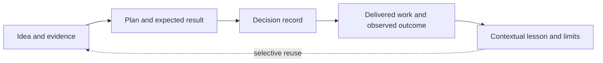

# Grounded Plan: research decisions and outcomes

Updated **14 October 2026**. This is repository documentation about the skill and its evaluation. Individual planning records live in a separate user-wide library. Start with the [research overview](overview.md), [pinned repository comparisons](repositories.md), and [pilot evidence](evaluation.md).

## What the research changed

The original requirement combined concise structured plans, useful diagrams, evidence checks, cross-checking and debate, and controlled overhead across engineering, product, and research. The survey covered 18 repository snapshots; selected source files were inspected, not every upstream runtime executed.

| Decision | Basis and limitation |
|---|---|
| Build a small standalone skill | `ce-plan` was the closest ready-made comparator; selected ECC, Ouroboros, Ralplan, and other mechanisms informed the design. Avoiding their full runtime dependencies fits the requested scope, but the custom candidate has not beaten them in a controlled benchmark. |
| Separate clarity, agreement, and evidence | A stable specification or agreeing reviewers cannot establish that its factual claims or future implementation are correct. Ouroboros's execution gate illustrates the value of separating executed checks from model review. |
| Scale review to the decision | Lean, standard, and deep modes bound review work. The pilot found no material improvement from additional critics on its engineering plan, so more debate is not a demonstrated default benefit. |
| Preserve outcomes for later planning | The user requested storing decisions, delivered artifacts, observed results, and lessons. This supplies a place to compare expectations with evidence instead of losing the result after handoff. |
| Keep records user-wide | The user selected a separate user-wide folder. The implementation default is `~/.local/share/grounded-plan/`, configurable without changing the skill. Repository docs describe the method and public research evidence; personal records remain outside the checkout. |

Detailed mechanisms, licenses, and immutable source references are in the [repository evidence](repositories.md). Those findings are tied to the 11 October snapshot; this update does not claim to repeat the upstream survey.

## Outcomes established so far

| Intended result | Observed result | Still unknown |
|---|---|---|
| A portable planning skill | Version 0.1.0 supplied a standalone instruction file, conditional review procedure, and scoped MIT license. | Comparative quality across real tasks and host differences. |
| Evidence-grounded planning | A synthetic engineering run found a real CSV defect with a probe; product and research runs exposed unsupported assumptions and evidence gaps. | Production engineering guarantees, real customer demand, and actual research effects. |
| Useful independent scrutiny | Standard review used one fresh critic; the deep component kept a critic and alternative author separate initially. Both stopped without a material dispute. | Quality gain from deeper review, cross-model effects, and behavior at the dispute cap. |
| Lower planning overhead | Instruction-level review budgets and selective source access limit workflow size. | Dollar savings or an optimal effort policy; no controlled cost benchmark was run. |
| A reusable outcome history | Version 0.2.0 adds a user-wide record/index contract and outcome capture. | Whether lessons improve later decisions over repeated real use. |

The original expectations above summarize the recorded research goal retrospectively; they are not newly claimed pre-registered evaluation hypotheses. The [0.1.0 pilot report](evaluation.md) retains its original scope and receipts.

The host's completed-goal meter reported **478,827 tokens and 1,761 seconds** for the initial research, construction, and pilot work together. That aggregate is not per-plan usage, a controlled comparison, or a bill; dollar cost was unavailable. It should not be presented as evidence that using the skill saves money.

## Storage and use

```text
~/.local/share/grounded-plan/
  index.md
  records/
    YYYY-MM-DD-topic-<random-suffix>.md
```

The root resolves from explicit `--store DIR` or a user-specified library folder, then `GROUNDED_PLAN_HOME`, then the default above. An explicit plan destination is respected without changing the library root. Existing plans are referenced where they already live; no automatic migration or competing copy is created.

A record contains the plan or its reference, project/topic context, original expectations, dated decisions, outcome entries, and lessons with applicability limits. Work may be completed while its intended benefit remains unmeasured. Results supplied by a user are labeled as reports unless separately verified. Outcome entries preserve earlier evidence and expectations; corrections and scope changes are dated amendments.



Examples:

```text
$grounded-plan compare rollout options
$grounded-plan <record-id> --outcome
$grounded-plan record what we learned from the onboarding experiment
$grounded-plan plan a migration --store ~/my-planning-library
```

The skill opens the index and a few relevant records, checks whether their evidence and conditions still apply, and cites useful prior work. `--outcome` matches an existing record and appends known results without restarting the planning workflow. Ambiguous matches require choosing the intended record before editing. Index rows are derived navigation; records remain authoritative if index repair is needed.

The workflow uses ordinary file tools, with no database, background watcher, scheduled follow-up, or required external provider. A request to update outcomes authorizes recording available results, not inventing evidence or launching new experiments. Private records are not automatically copied into repository documentation.

The executable contract is the prose in [SKILL.md](../../skills/grounded-plan/SKILL.md) and [records.md](../../skills/grounded-plan/records.md); [review.md](../../skills/grounded-plan/review.md) still governs optional critique. Installation follows the existing skill symlinks, so local edits take effect there without a second copied implementation.

## Validation of the outcome extension

One fresh-context forward test used an isolated library with two projects whose plans had the same title. The request named one record and supplied a user report of completed implementation plus a file reporting three passing tests. The original acceptance criteria required a p95 latency target under peak load and concurrent-retry safety; neither was measured by those tests.

| Check | Observed result |
|---|---|
| Correct record and root | Updated the explicitly selected record in the overridden temporary library; the other project was untouched. |
| Preserve expectations | Original plan, acceptance criteria, and decision text were retained verbatim. |
| Evidence distinction | Recorded implementation completion as user-reported and the suite result as an inspected report; no tests were rerun. Peak-load and concurrency acceptance remained unverified. |
| Status and index | Marked work completed on the user's report while leaving benefit/acceptance unproven; updated only that index row. |
| Data integrity | Parent checks confirmed the unrelated record and index row, input request, and evidence were unchanged; saved links resolved and receipt JSON parsed. |

The evaluator reported no material difficulty. This is one synthetic behavioral check, not a quality benchmark. An actual user-wide library was also initialized with the development record for this skill. Its local index and record links were checked separately; private record contents are not committed here.

Static checks covered local documentation links, Markdown fences, public-path hygiene, plugin version, and the old pilot's source hashes against commit `6397676`. Full frontmatter parsed correctly. As in 0.1.0, the bundled validator rejects this repository's required `argument-hint` extension; a projection omitting that field passed its checks. The extension does not change that known compatibility limitation.

Not exercised: simultaneous writers, denied filesystem permissions, ambiguous record selection, changed environment overrides across sessions, or repeated longitudinal reuse. File-edit coordination and index repair are instructions to the host agent, not transactional guarantees. Diagram rendering was not tested.
