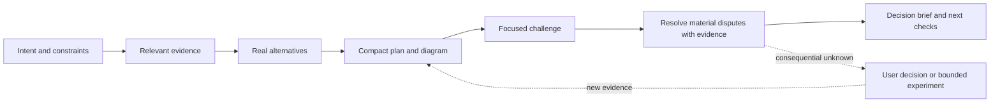

# Planning that is concise, illustrated, checked, and affordable

Research snapshot: **11 October 2026**; candidate built **12 October 2026**. Scope: engineering and architecture first; reusable for product decisions and broader research. Status: **research dossier and trial skill available; defaults remain recommendations, not recorded user preferences**.

Start here. [Repository evidence](repositories.md) contains the comparisons and pinned source links. [Skill design](skill-proposal.md) explains the choices behind the [candidate](../../skills/planning/SKILL.md). [Pilot evaluation](evaluation.md) records observed behavior and limitations. [Source manifest](sources.json) records 18 repository snapshots and retrieved-file hashes.

Follow-up, **14 October 2026**: [research decisions and outcomes](outcomes.md) connects these findings to versions 0.2.0–0.3.0: the user-wide planning library, explicit planning boundary, and selective research scouts. The upstream repository snapshot remains unchanged.

Follow-up, **15 October 2026**: version 0.4.0 removes effort settings at the user's request. The skill infers scrutiny from task context while retaining bounded research and review. Earlier pilot results describe the modes used at that time.

Output follow-up, **15 October 2026**: version 0.5.0 adopts a shorter, consistent brief with an architectural view. Detailed code choices remain with the implementer. See the [design contract](skill-proposal.md#compact-artifact-contract) and [outcomes](outcomes.md).

Research follow-up, **16 October 2026**: [plan length and structure](output-design.md) compares current upstream output rules and architecture guidance. The user adopted its recommendation in version 0.6.0: adaptive length, flexible sections, concise writing within sections, and one home for each fact.

Research follow-up, **20 October 2026**: [learning from planning conversations](conversation-learning.md) compares memory, background reflection, playbook updates, and evaluated skill optimization. It proposes automatic plan reconciliation and scoped learning from Q&A; this extension is not implemented.

Storage follow-up, **21 October 2026**: [named sessions and artifact discovery](session-artifacts.md) proposes grouping new planning artifacts under readable session names and linking existing learning artifacts through a shared entry point. Storage migration and learning integration remain planned.

## Recommendation

Build a small, standalone planning skill, using **Compound Engineering's `ce-plan` as the strongest ready-made comparator**, ECC's simple inline planning as the cost baseline, and selected verification and review ideas from Ouroboros, Ralplan, and this toolkit. Do not make the new skill depend on any of those systems.

The useful unit is a **decision with evidence, alternatives, a diagram where helpful, and a way to discover that it is wrong**. A longer plan, more reviewers, and a higher self-assigned confidence score do not establish that the decision is better.

This recommendation is a design judgment from source inspection, **not a measured quality or cost ranking**. The strongest objection is that `ce-plan` already covers much of the desired behavior and maintaining another skill may cost more than adapting it. A small candidate pilot against native planning is now available; a controlled comparison with `ce-plan` remains worthwhile before declaring a winner.

## What was actually verified

- Resolved ECC to `affaan-m/ECC` (the former `everything-claude-code` URL redirects there) and Ouroboros to `Q00/ouroboros`.
- Retrieved public repository metadata, immutable commit IDs, file trees, READMEs, and available root licenses for 18 repositories. Inspected selected planning prompts, review procedures, and implementation paths. The manifest lists downloads; it is not a claim of exhaustive code review.
- Cross-checked advertised workflows against source where it matters: inline versus delegated planning, cross-model prerequisites, score gates, review independence, revision limits, and mechanical versus model-based acceptance.
- Read primary research abstracts and official engineering guidance to challenge the assumption that additional debate necessarily improves planning. These are supporting evidence about mechanisms, not direct evaluations of these skills.
- Did **not** install or execute the upstream systems, run a controlled cross-model benchmark, or establish end-to-end reliability. No comparative dollar estimates are claimed. The separate candidate pilot checks a few behaviors; upstream runtime integrations and general planning quality remain unmeasured.

The distinction matters. A prompt can instruct an agent to verify something; only a run record can show that it did. A repository can have tests without those tests measuring planning quality.

## The landscape in one table

Costs below describe workflow shape and expected overhead, not measured billing. Details and current-version qualifications are in the [repository evidence](repositories.md).

| Approach | Best contribution | Gap for this request | Cost tendency |
|---|---|---|---|
| ECC `/plan` | Inline, repository-grounded implementation plan; optional visual review | No independent critic in the default command | Low starting overhead |
| ECC `/multi-plan` | Two models explore and optionally draft | External `ccg-workflow`; role-based model authority is weaker than evidence arbitration | Multiple model passes |
| Ouroboros | Socratic intake, explicit criteria, staged evaluation, conditional escalation | Full agent runtime; clarity/convergence differs from correctness | Adjustable, potentially substantial |
| Symposium | Small, portable extraction of Ouroboros-style intent discovery | Interview and semantic boundaries, not complete evidence-backed planning | Human attention can dominate |
| Superpowers | Right-sized discovery, builder check, precise implementation handoff | Coding plan still prescriptive; current plan review is self-review | Moderate, depends on path |
| OMC Ralplan | Alternatives, steelman opposition, architect and critic review, decision record | Up to five review iterations; broader runtime | Moderate to high |
| OMX Plan / Ralplan | Lightweight Codex plan or stronger consensus path | Current Ralplan is substantially coupled to runtime/lifecycle rules | Low for Plan; higher for Ralplan |
| Compound Engineering `ce-plan` | General planning, selective research, diagrams, depth selection, document review | Many linked procedures; planning forbids executing tests | Closest complete fit, variable overhead |
| gstack | Product/engineering lenses, coverage diagrams, outside challenge | Large review surface, helper/runtime dependencies, frequent decisions | High human/process overhead for small plans |
| Planning with Files | Durable plan, findings, progress, recovery | Persistence does not decide whether a plan is good | Small files, potentially recurring hook cost |
| Matt Pocock skills | Decision-tree interviews; distinguish facts from user decisions | Exhaustive questioning can expand human time; delegates need their dependencies | Small prompts, variable interview length |
| GSD / GSD Core | Goal-backward coverage and task dependency checking | Explicit development framework beyond requested scope | Multi-stage orchestration |
| Plannotator | Annotated visual review of plans and revisions | Presentation/feedback layer, not reasoning or verification | Low model cost; local runtime |
| Aider | Separate discussion from execution; architect/editor specialization | Architect mode edits code; no independent plan critic by default | Useful routing pattern |
| LLM Council | Separate initial answers, anonymized ranking, synthesis | Opinions/rankings lack a factual verifier; no root license found | Fan-out and all-answer review |
| Open Deep Research / GPT Researcher | Evidence acquisition, source synthesis, configurable research | Research reports need conversion into decisions and executable plans | Search and context can dominate |
| Sequential Thinking MCP | Explicit revisions and branches in a thought log | No external truth check or independent reviewer | Extra calls without guaranteed benefit |
| MADR / C4 | Small decision records and purpose-specific diagrams | Not agent planning skills | Cheap representational tools |

## Current-version findings that change the advice

**ECC:** the `/plan` command now says to run inline and avoid subagents by default. Its separate `agents/planner.md` still specifies a high-end model. Describing all ECC planning as an expensive planner agent would be wrong. Plan Canvas supports Mermaid and anchored human feedback. `/multi-plan` explicitly requires an external runtime; it is not supplied by the base install. [Pinned sources](repositories.md#ecc).

**Ouroboros:** the ambiguity threshold exists in code, but the current scorer also has per-dimension clarity floors and completion-related conditions. More importantly, evaluation code distinguishes executed mechanical evidence from advisory model reviews. A model consensus cannot alone mint execution approval. This is a useful principle to borrow, with a clear separation between a plan's feasibility and implementation that has actually been tested. [Pinned sources](repositories.md#ouroboros).

**Superpowers:** search results still surface older review loops. The inspected October snapshot uses a fresh builder check for written designs and a self-review checklist for implementation plans. It also explicitly warns against plans that transcribe implementation bodies. Evaluate the current files, not historical descriptions. [Pinned sources](repositories.md#superpowers).

**OMC and OMX:** they should not be collapsed into one generic “Ralplan.” At the inspected commits, OMC's architect and critic review the same fixed snapshot without seeing each other's findings; OMX's Ralplan passes the completed architect review to the critic. The latter is a sequential refinement chain, not two blind opinions. [Pinned sources](repositories.md#omc-and-omx).

**Maintenance and reuse:** the original `gsd-build/get-shit-done` and `langchain-ai/open_deep_research` repositories are archived. `open-gsd/gsd-core` is active. Karpathy's Council snapshot has no root license file and no GitHub-detected license; treat it as a design reference, not a ready-to-relicense component. MCP Servers is undergoing a licensing transition, so a blanket “MIT” label is inaccurate. [Snapshot evidence](sources.json).

## The approaches worth combining

This is a small workflow, not a new specification system. It needs no project bootstrap, mandatory PRD, issue tracker, state database, or autonomous execution loop.

| Layer | Question it answers | Useful mechanism |
|---|---|---|
| Intent | Are we solving the right problem? | Goal, non-goals, constraints, design-changing questions |
| Grounding | What is actually true here? | Repository inspection, current primary sources, evidence ledger |
| Choice | Why this approach? | Minimal/reuse baseline, one serious alternative, reversal conditions |
| Verification | How would we find a mistake? | Trace requirements to checks; run appropriate existing checks or isolated probes |
| Challenge | What did the planner miss? | Fresh focused critic; blind alternative only when stakes justify it |
| Communication | Can the user understand and resolve it? | Short brief, useful diagram, decision IDs, expandable evidence |
| Persistence | Can another session continue faithfully? | One canonical plan plus a linked evidence appendix when needed |

Treat these as separable capabilities. Persistence is not verification. A picture is not evidence. A second model is not an independent source. Agreement is not validation.

## What “verified” should mean

Use explicit evidence labels rather than a single percentage:

| Label | Meaning | Example |
|---|---|---|
| Observed | Read in the actual artifact/source | The existing API accepts a cursor |
| Corroborated | Supported by independently originating evidence | Source implementation and a separately executed behavior check agree |
| Tested | A named check ran, with result and limits | An existing test suite passes on the recorded commit |
| Inferred | Reasoning from evidence, not directly demonstrated | Reusing this queue should reduce operational change |
| Assumed | A working premise awaiting confirmation | Expected workload remains below a stated bound |
| Unknown | Material information is unavailable | Vendor's undocumented timeout behavior |

One claim can be observed and tested. A passing test establishes only the behavior it exercises. Two websites repeating the same README do not corroborate a claim independently. A future test in the plan is **planned verification**, not executed evidence.

For a consequential claim, seek a counterexample or a second evidence channel. For an ordinary local fact, reading its authoritative definition may be sufficient. “Verify everything” without prioritization is neither cheap nor achievable.

## What the research supports—and does not

**Start simple, add complexity for demonstrated value.** Anthropic's engineering guidance favors composable patterns and evaluation-driven increases in complexity. This supports a small default and conditional reviewers; it does not establish that one particular skill is best. [Building Effective Agents](https://www.anthropic.com/engineering/building-effective-agents).

**Debate needs a mechanism beyond persuasion.** A seven-benchmark study found that voting accounted for much of the gains commonly attributed to multi-agent debate. Its martingale argument depends on the model's assumptions; it is not proof that all real debates are useless. A useful design implication is to preserve separate initial judgments and require new evidence for revisions. [Debate or Vote, v2](https://arxiv.org/abs/2508.17536v2).

**Coordination must fit the task.** The revised scaling study compares 260 configurations over six benchmarks and reports large differences between decomposable tasks and sequential planning. Its results caution against making a panel mandatory for every plan. Transfer to engineering planning remains an inference. [Scaling Agent Systems, v3](https://arxiv.org/abs/2512.08296v3).

**Homogeneous discussion can be costly and misleading.** The Cost of Consensus studies ten-agent teams of 7–8B models on two reasoning benchmarks, finding worse cost/accuracy tradeoffs for unguided peer exchange than isolated correction in that setting. It does not test frontier-model repository planning or a carefully grounded critic. [Cost of Consensus](https://arxiv.org/abs/2605.00914v1).

**There is also positive evidence for structured debate.** An October 2026 preprint separates generating a correct candidate from identifying it through evidence-sensitive finalization. This argues for complementary proposals plus verification, not a blanket rejection of debate. It is very recent, covers two backbones, and is not a replicated engineering-plan result. [When Debate Helps](https://arxiv.org/abs/2610.04686v1).

**Self-review is a useful pass, not independent proof.** Earlier work found limitations in intrinsic reasoning correction without external feedback. Model capabilities have changed; use the finding as a warning about circular verification rather than an eternal limitation. [Self-Correction study](https://arxiv.org/abs/2310.01798).

These sources justify a hypothesis worth testing: **grounded planning plus one targeted challenge should be a better default candidate than an always-on council**. They do not yet validate it for this user's tasks.

## The cost choices

“Cheap” has at least four dimensions: model/search charges, latency, user attention, and maintenance. A ten-turn interview can be monetarily cheap and operationally expensive. Parallel reviews reduce waiting but do not inherently reduce total tokens.

| Scrutiny | Shape | Use when | Main limitation |
|---|---|---|---|
| Source checks and self-check | One planner | Bounded and reversible work with a clear approach | No independent critique |
| Fresh critic | One critic and at most one targeted follow-up | Meaningful alternatives or dependencies worth challenging | Critic sees the plan and may inherit its framing |
| Blind alternative and debate | Critic plus independent alternative; at most two dispute rounds within six total review calls | Costly reversal, contested approach, consequential unknowns | More input duplication, synthesis, and human decisions |

The user selected inference from task context rather than an effort setting. These remain **provisional budgets**, not measured optima or cost multipliers. A full critic pass can be cheaper than another research expedition; a long context can reverse that comparison. Count work by stage, not just agents.

For API billing, use actual stage usage:

`total = Σ(input_uncached × input_rate + input_cached × cache_rate + output × output_rate) + search/tool charges`

Use the provider's actual billing units and accounting for reasoning tokens. Subscription quota consumption and elapsed time need separate reporting. Without telemetry, report review calls, retrieval work, and output size as proxies; never invent dollar totals.

Spend extra effort where the expected reduction in a consequential mistake exceeds the added model and human cost. In practice: name the uncertain claim, what would change the choice, and the cheapest observation that could resolve it. Avoid fictional probabilities when none are available.

## Keeping the output short without weakening it

Make the **front page** easy to scan and the **supporting evidence** inspectable. Let the task determine length; add detail when it changes a decision, exposes a dependency, or defines acceptance. Keep critical constraints and caveats visible.

Use a recognizable progression through recommendation, approach/architecture, delivery, and uncertainties; combine, rename, or omit headings to fit the task. Start each section with its conclusion and decisive support. Give each fact one home and reference it elsewhere. Keep architectural components or stages, responsibilities, interactions, and important boundaries visible, with milestones and acceptance conditions. Leave code-level design and detailed test matrices to the implementer. Detailed source excerpts, comparison matrices, and review receipts belong behind links when long.

Choose the diagram by the uncertainty: component/context for boundaries, sequence for interactions, state for lifecycle, dependency graph for order, and a decision tree for dependent choices. Mark current versus proposed behavior and check it against the prose. Do not draw a diagram merely to satisfy a quota. C4 itself recommends using only the zoom levels that add value. [C4 guidance](https://c4model.com/diagrams).

## Reuse versus build: the strongest cases

| Route | Case for it | Case against it | Recommendation |
|---|---|---|---|
| Use `ce-plan` | Already combines most requested capabilities and supports non-software work | Supporting procedures, mandatory handoffs, and upgrade drift may be too much | Best ready-made trial |
| Adapt ECC `/plan` | Small baseline; Canvas supplies excellent review interaction | Need to add evidence states, critic policy, and domain adaptation | Best minimal upstream starting point |
| Use Ralplan | Explicit opposing case and quality criteria already present | Consensus loops/runtime conventions become part of the dependency | Choose if formal debate is the primary preference |
| Extract from Crucible | Already matches the user's emphasis on challenged assumptions | Existing workflow is build-oriented and has substantial fan-out | Reuse principles; preserve its current scope |
| Write a thin skill | Exact scope, portable prose, optional research/review depth, easy to inspect | We own maintenance and must prove it adds value | Recommended candidate, pending evaluation |

The proposed skill's defaults and a concrete evaluation plan are in [skill-proposal.md](skill-proposal.md). The next decision is **which route to trial and which assurance policy to test**, not which framework to install permanently.
