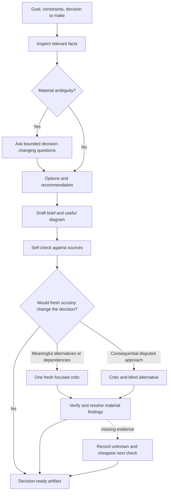

# A small planning skill: design and decisions

Status: **a trial implementation is available as [grounded-plan](../../skills/grounded-plan/SKILL.md), with a [pilot evaluation](evaluation.md)**. This document preserves the design rationale and choices the user can resolve. Return to the [research overview](overview.md) and [repository comparisons](repositories.md).

**14 October follow-up:** the user approved outcome capture and selected a separate user-wide folder. Version 0.2.0 implements that extension; [research decisions and outcomes](outcomes.md) documents its contract. This supersedes the original project-local persistence suggestion below. It does not settle the remaining cost-policy choices.

**15 October follow-up:** version 0.4.0 removes effort settings at the user's request. The user surface and scrutiny policy below now reflect inference from task context. Historical pilot results retain their original mode labels; the numeric budgets remain provisional.

## Intended result

Turn an engineering, product, or research question into a concise decision brief that another person can inspect and act on. Show why the recommendation follows from evidence, what remains uncertain, how the alternatives differ, and which checks would expose a mistake. Stop at planning unless the user has separately authorized implementation.

Name: **`grounded-plan`**. This is an original small skill, not a fork of a runtime. Its [MIT license](../../skills/grounded-plan/LICENSE) covers the self-contained skill folder. Design inspirations are linked in this dossier; upstream code and prompt text were not copied into the skill. The license does not relicense the rest of this repository, which has no root LICENSE file.

## User surface

```text
$grounded-plan decide how to add background exports
$grounded-plan compare two product rollout approaches
$grounded-plan design a research plan for the retention hypothesis
$grounded-plan path/to/existing-plan.md --review
```

Exact slash/dollar invocation depends on the host. No CLI, MCP server, external model provider, browser, or repository bootstrap is required. Native tools provide reading, research, optional execution of appropriate checks, and fresh review where permitted. Additional tools can improve the workflow but are not prerequisites.

Infer useful scrutiny from uncertainty, consequences, reversibility, and dependencies. Start with source checks and self-check; add a critic or a blind alternative when it could change the plan or resolve a consequential gap. Do not ask the user to choose a level. Stated time, cost, scope, and delegation limits take precedence; numeric budgets remain provisional.

## Workflow



1. **Frame.** State the outcome, relevant constraints, non-goals, and the decision the plan must support. Separate user requirements from the planner's assumptions. Inspect discoverable facts before asking about them. Ask only questions whose answers could change the approach, scope, success criterion, or costly commitment.
2. **Ground.** Read relevant code/artifacts; use current primary sources for external facts that matter. Track material claims with provenance and limits. Two summaries of the same upstream source count as one evidence origin.
3. **Choose.** Compare the smallest viable/reuse approach with one serious alternative. Add another only when it changes the choice. Name the deciding tradeoff and what evidence would reverse the recommendation. Do not generate decorative alternatives.
4. **Sketch and plan.** Use the representation that reveals the problem: sequence, component, state, dependency, decision tree, or a table. Define independently checkable deliverables and dependencies at the appropriate level of detail. Avoid speculative implementation bodies.
5. **Check and challenge.** Verify paths, contracts, source claims, dependency wiring, and criterion coverage. Infer additional scrutiny from the task and evidence. Resolve disputed facts by inspection/checks and preference disputes through the user. Do not turn a preference into an alleged defect.
6. **Compress and hand off.** Keep the recommendation and decisions prominent. Preserve the evidence and rejected alternatives behind links where useful. Report actual verification and review performed, remaining unknowns, and the stopping reason.

## Assurance and cost policy

| Task context | Useful work | Stop rule | Honest label |
|---|---|---|---|
| Clear, reversible work | One planner, source checks, a self-check | Deliver once the decision and limits are clear | Self-checked |
| Meaningful alternatives or dependencies | Add one fresh critic, then targeted fixes/checks | One initial critique; at most one targeted follow-up if a material issue changed | Independently critiqued, same-model if applicable |
| Costly reversal or consequential disputed assumptions | Critic plus a blind alternative author, then evidence-led resolution | At most two dispute rounds within six total review calls, including earlier critic calls; stop earlier on no new evidence | Report exact model/context diversity |

Budget the research too: begin with the smallest set of questions and sources that could settle the decision. Expand only when a missing fact could change the recommended option or leave a consequential criterion unsupported. A call cap is a ceiling, not a quota; it does not reset when scrutiny increases.

If the runtime lacks or disallows fresh agents, use the strongest permitted check and say that independent critique was unavailable. Never simulate multiple personas in one context and label them independent. A second provider is optional; naming a different role does not establish a different model. Do not add paid services just to fill a review role.

The skill's caps are instructions, not a billing enforcement mechanism. If hard monetary limits are required, the host/API layer must enforce them. Report measured usage when available; otherwise use clearly labeled work proxies. Changing a diagram or resolving a wording issue does not justify replaying every research and review stage.

## The critic's job

The critic receives the task, constraints, plan snapshot, acceptance criteria, and relevant evidence pointers. It does not need the complete conversation or the planner's private reasoning. It checks:

- A wrong premise, unsupported material claim, or overlooked existing solution.
- A criterion that no deliverable or check satisfies.
- A missing dependency, failure path, or infeasible interface.
- A materially smaller solution that still meets the goal.
- A diagram that disagrees with the plan or with observed current behavior.

Return only material findings, each with the affected claim/task, evidence, consequence, and a specific correction or discriminating check. A clean outcome is valid; do not manufacture disagreement.

When an independent approach is warranted, a blind alternative author initially receives the brief and evidence, **without** the preferred option or first plan. Compare the resulting choices before exchanging findings. In a dispute, a changed stance must cite new evidence or a corrected inference. Stop on repeated arguments. Preserve unresolved factual uncertainty and user-value tradeoffs; do not settle them by vote.

## Compact artifact contract

This is a content checklist, not a demand for nine headings on every small task:

| Content | What it should contain |
|---|---|
| Decision | Recommended approach, why it fits, what would change it |
| Boundaries | Goal, non-goals, constraints, user decisions |
| Options | Serious alternative and the relevant tradeoff |
| Shape | A diagram if relationships/sequence/state are consequential |
| Deliverables | Outcome, affected area, dependency, acceptance check |
| Evidence | Material claims, provenance, verification state, limits |
| Risks | Failure scenario, mitigation, reversal/rollback when relevant |
| Resolutions | Decision IDs, options, recommendation, cost of leaving open |
| Receipt | Checks and critique actually done; unknowns; stop reason |

A substantive front page should usually fit roughly 500–900 words; do not hide a critical caveat to hit the target. Save a separate evidence appendix only when it prevents either a bloated brief or lost provenance. Reuse the project's document location and naming convention. Outside a repository, use the user's requested destination or the host's artifact workspace and return a durable link.

### Example evidence rows

| ID | Claim | Basis | State | Limit / next check |
|---|---|---|---|---|
| E1 | Existing export worker accepts a durable job ID | Actual source path and symbol | Observed | Does not establish retry safety |
| E2 | Reusing the worker minimizes new operations | E1 plus current deployment topology | Inferred | Reconsider if capacity probe fails |
| E3 | Users tolerate delayed completion | User statement or interview evidence | Assumed until supplied | Confirm before promising async-only UX |

These are illustrative rows, not claims about this repository.

### Example task row

| Task | Deliverable | Depends on | Acceptance check |
|---|---|---|---|
| T1 | Demonstrate retry-safe export creation in a disposable probe | Agreed idempotency requirement | Repeated identical requests produce one job; record observed result and scope |

Proposed probes remain future work until run. Do not write “verified” because the plan includes a test. An existing-suite baseline can be recorded separately from the tests that will validate a future implementation.

## Domain adaptation

| Engineering | Product | Research |
|---|---|---|
| Interfaces, files, migration/rollback | Audience, hypothesis, constraints, rollout | Question, evidence inclusion rules, competing explanations |
| Acceptance tests and operational checks | Observable outcomes and guardrail metrics | Discriminating observations and falsification criteria |
| Sequence/state/dependency diagram | Journey/decision/rollout diagram | Evidence map/experiment dependency diagram |
| Technical unknowns | User-value and feasibility unknowns | Source gaps and uncertainty |

Do not impose code paths, TDD, or deployment terminology on other domains. Do not claim to validate demand, research findings, or future performance merely by checking the plan's structure.

## Evaluation and remaining comparisons

The [pilot record](evaluation.md) supplies runnable fixtures and outputs for an initial native-planning comparison and engineering, product, and research behavior checks. It does not complete the broader benchmark below; the candidate is version 0.1.0, not a demonstrated winner.

Compare **native planning**, **ECC-style inline planning**, **`ce-plan`**, and the **candidate**. Start with a small pilot rather than an expensive broad benchmark. Keep the same task, available sources, model, and budget envelope within each comparison. Record different capabilities or setup constraints; do not pretend incompatible harnesses are identical.

| Case | What a good result must expose |
|---|---|
| Small reversible change | Minimal plan; no unnecessary council or lengthy interview |
| Brownfield feature already partly implemented | Reuse discovered from actual files; no invented paths |
| Data migration with a hidden destructive step | Missing safety condition and a concrete validation/rollback path |
| Architecture choice with an attractive but unsuitable dependency | Serious minimal alternative and evidence-backed rejection |
| Product proposal with vague success | Few decision-changing questions; observable outcome; no invented customer evidence |
| Research question with conflicting sources | Provenance, source dependence, competing explanations, unresolved contradiction |
| No web or second reviewer available | Transparent limits and useful progress without fabricated verification |
| Plan whose diagram contradicts prose | Mismatch caught before handoff |

Use blind output grading where practical. Score material defects caught, unsupported claims, criterion coverage, decision clarity, user interruptions, wall time, and actual tokens/tool charges where available. Also inspect the output length and whether another agent can act without reconstructing hidden decisions.

Start with three representative tasks and repeat promising comparisons to estimate variability. A single successful example or frontmatter validation is not a quality benchmark. Choose the cheapest approach meeting the quality floor; document inconclusive results rather than inventing a winner. [Official skill-evaluation guidance](https://developers.openai.com/blog/eval-skills).

## Decisions for the user

| ID | Choice | Recommendation | Alternative |
|---|---|---|---|
| D1 | Reuse or build | Trial a thin custom skill against `ce-plan` | Adopt `ce-plan` first and customize only demonstrated gaps |
| D2 | Normal assurance | Resolved 15 October: infer scrutiny from task context, with no effort selector | Always one critic, or always cross-model review |
| D3 | Output | Short front page, linked evidence, Mermaid when useful | Full plan always visible |
| D4 | Human interaction | Batch only decisions that can change the plan; recommend answers | Exhaustive Socratic interview |
| D5 | Verification boundary | Source inspection and appropriate non-destructive checks; explicit limits | Research-only, with all execution checks deferred |
| D6 | Review UI | Native artifact/chat first | Add ECC Canvas or Plannotator after a compatibility trial |
| D7 | Open-source packaging | Original self-contained skill with a scoped MIT license and attribution | Select another license or license the whole toolkit |

The original overview preceded implementation. The user has since selected a custom skill, user-wide records, and scrutiny inferred from task context; [dated outcomes](outcomes.md) record those decisions. Scope remains engineering first, with broader product and research applicability. No optimal numeric budget or comparative cost benefit has been established.
